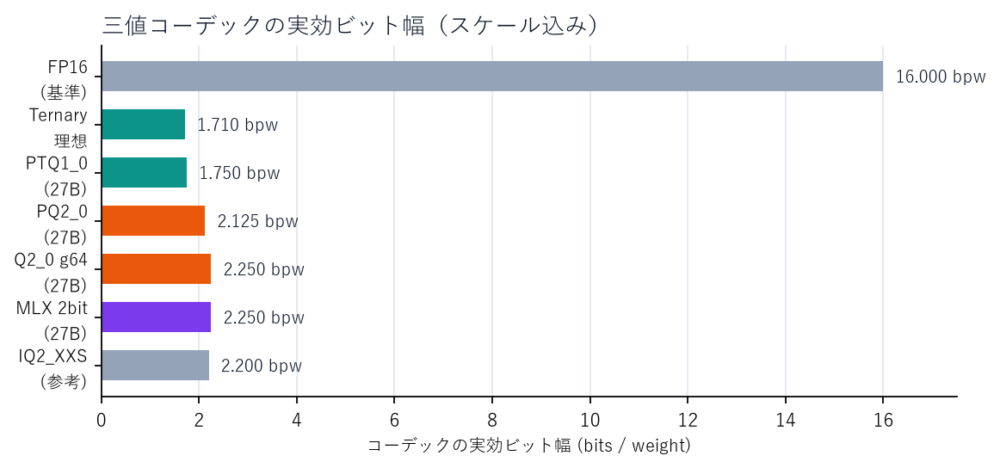
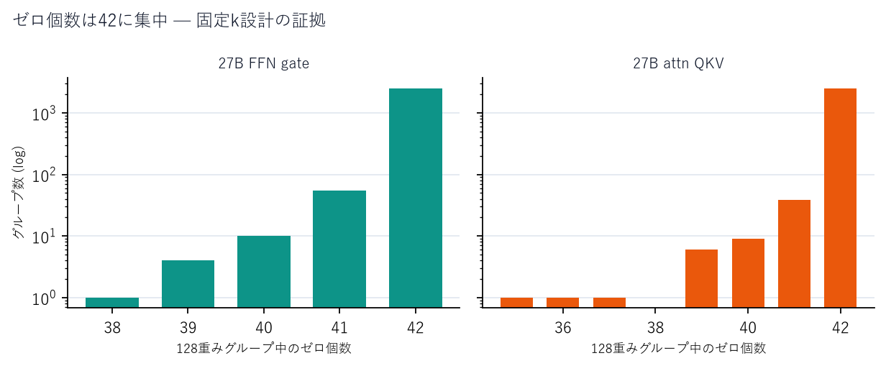
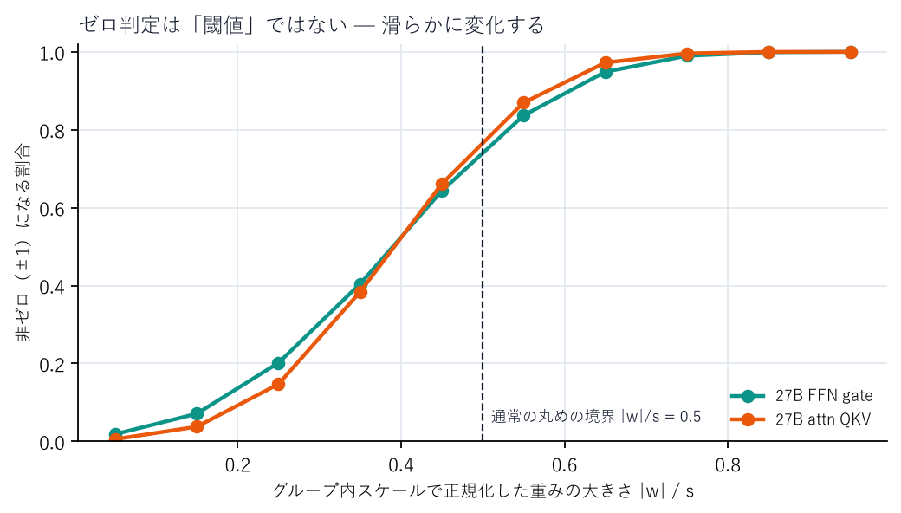
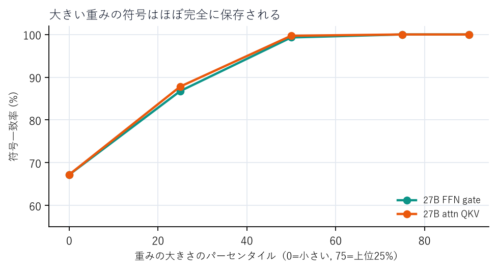
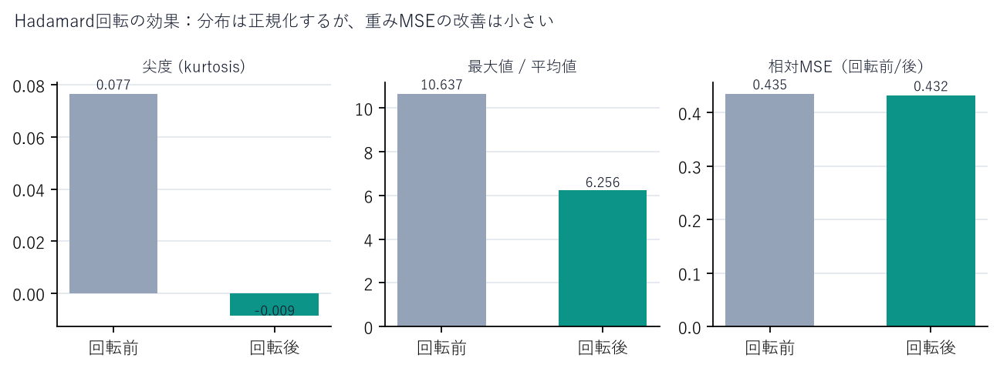
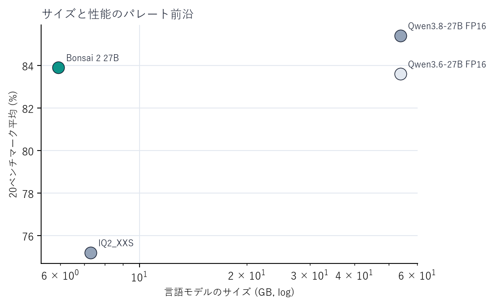
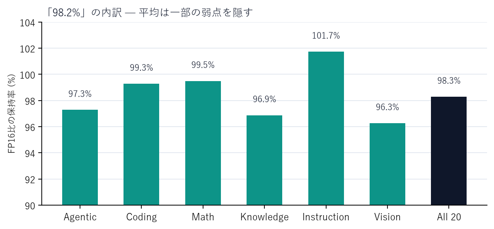

<!-- Generated from docs/ by tools/assemble.py. Edit docs/, not README.md. -->

# Ternary Bonsai 徹底解剖

**27B級を5.9GBで動かす「1.58-bit」の正体を、GGUFバイナリからリバースエンジニアリングする**

<p align="center">
  
</p>

> **検証日**: 2026-10-25 / **対象**: PrismML Ternary Bonsai 2 27B（GGUF PTQ1_0 / PQ2_0 / Q2_0）、2B、1-bit Bonsai 8B、Qwen3.8-27B / Qwen3.5-2B / Qwen3-8B
>
> このレポートは、公開されている一次資料（ホワイトペーパー、モデルカード、公式ドキュメント、llama.cppフォークのソース）と、実際にダウンロードしたGGUFバイナリの独自解析を突き合わせたものです。ベンダーの主張をそのまま写すのではなく、**「どこまでが観測で、どこからが推測か」**を明示します。

---

## 3行でわかる結論

1. **27B級の言語モデルが5.95GB。** 重み1個あたり1.75ビットで、FP16の約9分の1。262Kコンテキストとツール呼び出しまで入っている。画像入力は別途0.63GBのmmprojが必要。
2. **中身は `{-1, 0, +1}` だが、単純な「丸め」ではない。** 128個の重みグループごとに**42個をゼロ**にし、残り86個の**符号をほぼ保存**する。上位25%の重みの符号一致率は100%、非ゼロ全体でも99.97%。これは「スパース化された符号場」とでも呼ぶべき表現だ。
3. **速さの鍵は回転とカーネル。** Hadamard回転で外れ値を全体に散らし、三値コードを展開せずに整数積和（dp4a）で消費する。PTQ1_0 / PQ2_0 / Q2_0の3つのGGUFは、**検証したテンソルでは**同じ三値重みの別パッケージであることを実測で確認した。

> **ひとことで**: Bonsaiは「三値に丸めたモデル」ではなく、**「符号を保ったまま3分の1を間引いたモデル」を、回転と専用カーネルで実用速度に乗せたもの**です。

---

## このレポートの読み方

| あなたの持ち時間 | 読む場所 | 得られるもの |
|---|---|---|
| **3分** | 上の3行 + [第1章](#1-三値量子化とは何か158ビットの数学) + [第6章](#6-リバースエンジニアリングの結論42個のゼロと符号の保存) | Bonsaiの正体を一言で説明できる |
| **30分** | 第1〜8章 | 三値量子化の理論、Bonsaiの設計、ベンチマークの読み方 |
| **3時間** | 全文 + 付録 | GGUFのバイト列からカーネル実装まで、再現可能なレベルで理解できる |

数式は最小限にし、必要なものは[付録A](#付録a-数式と導出)にまとめました。専門用語は[用語集](#付録c-用語集)で定義しています。

---

## 目次

- [0. 先に結論：12の発見](#0-先に結論12の発見)
- [1. 三値量子化とは何か（1.58ビットの数学）](#1-三値量子化とは何か158ビットの数学)
- [2. Bonsai 2の全体像](#2-bonsai-2の全体像)
- [3. 解析手法と証拠の連鎖](#3-解析手法と証拠の連鎖)
- [4. GGUFの解剖](#4-ggufの解剖)
- [5. 三値フォーマットの実装](#5-三値フォーマットの実装)
- [6. リバースエンジニアリングの結論：42個のゼロと符号の保存](#6-リバースエンジニアリングの結論42個のゼロと符号の保存)
- [7. 回転：なぜHadamardを掛けるのか](#7-回転なぜhadamardを掛けるのか)
- [8. カーネルと速度](#8-カーネルと速度)
- [9. ベンチマークとファクトチェック](#9-ベンチマークとファクトチェック)
- [10. 他の三値量子化との比較](#10-他の三値量子化との比較)
- [11. 実運用ガイド](#11-実運用ガイド)
- [12. 未解決問題とロードマップ](#12-未解決問題とロードマップ)
- [付録A. 数式と導出](#付録a-数式と導出)
- [付録B. 再現手順](#付録b-再現手順)
- [付録C. 用語集](#付録c-用語集)
- [参考文献](#参考文献)

---

## 0. 先に結論：12の発見

以下は、本レポートで**新たに観測・導出したもの**と、**一次資料から確認したもの**の混合です。各項目の確度は本文で示します。

1. **27B言語モデルの実測は1.765 bpw、5.935GB。** テンソル単位で計算すると、三値テンソル26.87B個が1.75 bpw、高精度テンソル26.24M個がF32/BF16。合計5.935GBで、ファイルサイズ5.947GBと整合する。
2. **高精度の例外は26,238,464個（0.0976%）。** 内訳は `ssm_alpha` / `ssm_beta`（BF16、23.59M）と、`ssm_conv1d`・各種norm・`ssm_a`・`dt_bias`（F32、2.65M）。ホワイトペーパーの表と**1個単位で一致**した。
3. **三値グループは128個で、ほぼ必ず42個がゼロ。** 27BのFFN gateでは、2,560グループのうち97.3%がちょうど42個、平均41.965個。2Bでも73.1%が42個。**「128分の42」は偶然ではなく固定k設計**。
4. **ゼロの選び方は「小さい順」ではない。** 大きさの下位42個との一致率は27Bで84.7〜87.5%。AUC（大きさで非ゼロを予測）は0.964〜0.975。**大きさは強い要素だが、唯一の要素ではない**。
5. **大きい重みの符号はほぼ完全に保存される。** 27Bの上位25%の重みはゼロにならず、符号一致率100%。非ゼロ全体でも99.97%。**符号を反転させるのではなく、小さい重みをゼロにする**設計。
6. **スケールはLS（最小二乗）に近い。** 保存されたスケールは、保存された三値に対する最適スケールの1.02〜1.04倍。absmaxの0.39〜0.40倍と小さい。**マスクが小さい重みも残す結果、最適スケールがabsmaxより小さくなる**、と解釈できる。
7. **単純な丸めとの一致率は87.6%（27B）/ 68.7%（2B）。** 重みMSEは、同じ32.8%ゼロの固定k top-86基線より5.5%/3.6%悪い（自由k LSより11%）。**重みの再構成誤差を最小化する手法ではない**。
8. **1-bit Bonsai 8Bの符号は、Qwen3-8Bの符号と75.4%しか一致しない。** バイナリ版も単純な `sign(w)` ではない。**Bonsai家系の根幹は「学習・最適化された低bit表現」**。
9. **Hadamard回転は「重み側が S H、活性側が H S」。** 重みは `W S H / √n`、活性は `H S x / √n` で、`(H S)(S H) = nI` により元の関数に戻る。実測でも `S H` 側だけが87.6%一致し、`H S` 側は33%だった。
10. **回転の効果は「分布の正規化」であって「重みMSEの劇的改善」ではない。** 尖度0.077→-0.009、最大値/平均10.6→6.3。相対MSEは0.4347→0.4318とほぼ変わらない。**効くのは外れ値の分散と、固定kマスクの選択の安定化**。
11. **3つのGGUFは、検証したテンソルではビット単位で同じ重み。** PTQ1_0とPQ2_0は三値・スケールとも完全一致。Q2_0 g64は同じ三値を保持し、128グループのスケールを64グループに**2回複製**する（2.125→2.25 bpwのコストは上流互換のため）。
12. **「98.2%」は算術的には正しいが、内訳は均一ではない。** 20ベンチマーク平均83.8935 / 85.354 = 98.29%。しかしカテゴリ別ではVision 96.3%、Knowledge 96.9%、Agentic 97.3%に対し、Math 99.5%、Coding 99.3%、Instruction 101.7%。**Terminal-BenchとSWE-benchは約75%**で、長horizonエージェント能力の保持は平均より低い。

> **最重要の結論**: Bonsaiの圧縮は「三値丸め」ではなく、**「回転空間での固定kスパース化＋符号保存＋グループスケール」**である。この設計により、1.75 bpwでも符号情報をほぼ失わず、27B級の推論を5.9GBに収めている。

> **本レポートの独自貢献**: (1) 128グループ中42個という固定kマスクの**バイトレベル検証**、(2) 非ゼロ符号一致99.97%という**符号保存の発見**、(3) PTQ1_0 / PQ2_0 / Q2_0の**ビット一致検証**、(4) 重み側 `S H` / 活性側 `H S` という**逆Hadamard折り込みの実測確認**、(5) 「98.2%」の内訳と、独立追試が旧世代に偏っている事実の整理。

---

## 1. 三値量子化とは何か（1.58ビットの数学）

### 1.1 三値はなぜ「1.58ビット」なのか

重みが `{-1, 0, +1}` の3値を等確率で取るとします。1個の重みを区別するのに必要な情報量は

$$
\log_2 3 \approx 1.58496\ \text{bit}
$$

です。これが「1.58-bit」の由来です。2ビットあれば4状態を表せますが、三値は3状態しか使わないので、**単純に2ビットで保存すると0.415ビット/重みを無駄にします**。この無駄を詰めるのが、後述のbase-3パッキング（PTQ1_0）です。

### 1.2 グループスケールを足すと1.71ビット

三値の `±1` に、グループごとのFP16スケール `s` を掛けます。

$$
w_i = s_g \cdot t_i,\qquad t_i \in \{-1,0,+1\}
$$

128個ごとにFP16スケールを1個置くと、スケールのコストは

$$
\frac{16}{128} = 0.125\ \text{bit/weight}
$$

したがって理想的な実効ビット幅は

$$
1.58496 + 0.125 = 1.70996 \approx 1.71\ \text{bit/weight}
$$

になります。27Bの実際のファイルは、これにパッキングの端数と高精度テンソルが乗って**1.765 bpw**です。

### 1.3 2ビットスロットの無駄と、base-3の詰め方

| 方式 | 1グループのバイト数 | 実効bpw | 特徴 |
|---|---:|---:|---|
| 2ビットスロット（PQ2_0 / Q2_0） | 34B / 128 | 2.125 | 展開が速い。4状態のうち1つは未使用 |
| base-3（PTQ1_0） | 28B / 128 | 1.750 | 5三値を1バイトに詰める。展開に工夫が要る |
| 理想（スケールのみ） | 27.36B / 128 | 1.710 | 実装できない情報理論の下限 |

PTQ1_0は、5個の三値を `0,1,2` のbase-3数とみなし、`0..242` を `0..255` にスケーリングして1バイトに格納します。243通りの三値を256個のバイト値のうち243個に単射で写すので、**コード利用率は243/256 = 94.9%**（13個のバイト値は未使用）。情報レートは `log2(243)/8 ≈ 99.06%` です。この詰め方で、2ビットスロットより**0.375 bpw**小さくなります。

### 1.4 QATとPTQ — 三値化の2大路線

三値化の方法は、大きく2つに分かれます。

- **QAT（Quantization-Aware Training）**: 訓練中に三値化をシミュレーションし、モデル自身に三値表現へ適応させる。BitNet b1.58が代表。大量の訓練トークンが必要だが、性能は高い。
- **PTQ（Post-Training Quantization）**: 訓練済みのFPモデルを、事後的に三値化する。GPTQやAWQが代表。安価だが、極端な低bitでは性能が落ちやすい。

Bonsaiはどちらでしょうか。ベンダーは「PTQ1_0」という名前を使っていますが、**実測はどちらか一方に単純化できません**。第6章で詳しく見ますが、結論は「**重みの再構成誤差を最小化するPTQではない。出力に敏感なマスク選択か、QAT/微調整を含む可能性が高い**」です。名前だけで判断してはいけません。

### 1.5 回転はなぜ効くのか

LLMの重みには、他の値より極端に大きい**外れ値（outlier）**が含まれます。外れ値があると、グループスケールがそれに引っ張られ、他の重みの分解能が落ちます。そこで、直交行列 `R` で重みと活性を回転し、外れ値を全体に分散させます。

$$
f(x) = W_{\text{orig}}\,x = \left(W_{\text{orig}} R^{-1}\right)\left(R x\right)
$$

`W_orig` は元の重み、`R^{-1}` は逆回転。保存される重みは `W_orig R^{-1}` です。`R` が直交行列なら `R R^T = I` なので関数は変わりません。QuaRotやSpinQuantはこの性質を使い、4-bit量化を容易にします。Bonsai 2は、この回転を**重みにあらかじめ折り込み**、実行時は活性側だけを回転します。重みを回転したまま保存するので、推論時に余計な重み演算は不要です。

### 1.6 ベイビーステップの例

4個の重み `[0.9, 0.1, -0.4, 2.0]` を三値化してみます。

1. グループスケール `s = max|w| = 2.0`。
2. `w/s = [0.45, 0.05, -0.2, 1.0]`。
3. 丸めると `[0, 0, 0, 1]`。再構成は `[0, 0, 0, 2.0]`。`0.9` と `-0.4` の情報が消えました。
4. スケールを小さく `s = 0.8` にすると、`w/s = [1.125, 0.125, -0.5, 2.5]` → `[1, 0, 0, 1]`。`0.9` は残りますが、`-0.4` は消え、`2.0` は `0.8` に飽和します。
5. Bonsaiの実測は、**4番目に近い**挙動です。スケールを小さめにして、大きい重みを飽和させ、小さい重みの符号をできるだけ残す。

この「スケールを小さくして符号を守る」設計が、第6章の核心です。

### 1.7 三値化の系譜（ミニ年表）

| 年 | 手法 | 何をしたか | Bonsaiとの関係 |
|---|---|---|---|
| 2016 | TWN | 三値重み + グループスケールの原型 | グループスケールの祖先 |
| 2016 | TTQ | 三値とスケールを訓練で学習 | 「学習する三値」の祖先 |
| 2023 | BitNet | 1-bitをfrom scratchで訓練 | QAT路線の代表 |
| 2024 | BitNet b1.58 | 三値 `{-1,0,1}` でFP16同等 | 三値LLMのマイルストーン |
| 2024 | QuaRot / SpinQuant | 回転で外れ値を消す | Bonsai 2の回転の理論的祖先 |
| 2025 | PTQTP / CAT-Q / Tequila | 三値のPTQ・QAT・deadzone対策 | Bonsaiの比較対象 |
| 2026 | Sherry / ITQ3_S | 1.25-bit疎化 / 3-bit回転 | 極限低bitの最新系 |
| 2026 | **Bonsai 2** | 三値 + 回転 + 固定kスパース + 専用カーネル | 本レポートの主役 |

---

## 2. Bonsai 2の全体像

### 2.1 ファミリー

PrismMLのBonsaiは、大きく4つの系統があります。

| 世代 | モデル | 重み | 回転 | 主な用途 |
|---|---|---|---|---|
| 1-bit Bonsai（2026-03） | 1.7B / 4B / 8B | `{-1,+1}` g128 | なし | 最小メモリ |
| Ternary Bonsai（2026-04） | 1.7B / 4B / 8B | `{-1,0,+1}` g128 | なし | 1-bitの上質版 |
| Bonsai 27B（2026-07） | 27B 1-bit / ternary | `{-1,+1}` / `{-1,0,+1}` | なし | 27Bの最初のリリース |
| **Ternary Bonsai 2（2026-09/10）** | **2B / 4B / 9B / 27B** | **`{-1,0,+1}` g128 + Hadamard** | **あり** | **本命** |

本レポートの主役は**Ternary Bonsai 2 27B**です。2026年9月17日公開。ベースはQwen3.8-27Bで、アーキテクチャは変更していません。

> **名前の注意**: `deepgrove-ai/Bonsai` という別の三値モデル（500M、from scratch）が存在します。本レポートのBonsaiは**PrismMLのBonsai**であり、DeepGroveのものではありません。混同注意。

### 2.2 アーキテクチャ

| 項目 | 仕様 |
|---|---|
| ベース | Qwen3.8-27B（hybrid attention） |
| パラメータ | 27.36B total（24.35B language + 2.54B embedding/LM head + 0.47B vision） |
| 言語モデル | 26.90B（GGUF実測） |
| ブロック数 | 64 |
| Attention | 48層がlinear attention、16層がfull attention（約75% / 25%） |
| MLP | SwiGLU |
| コンテキスト | 262,144トークン |
| 視覚 | 別パッケージのmmproj（Q8_0 / BF16） |
| 重み | Ternary g128 + FP16スケール + Hadamard回転 |
| ライセンス | Apache 2.0 |

**hybrid attention**は、三値化以上に効く設計です。64層のうち48層がlinear attentionなので、KVキャッシュが育つのは16層だけ。262KコンテキストでもKVキャッシュが現実的なサイズに収まります。三値化で重みを5.9GBにしても、KVキャッシュが17GBあれば意味がありません。Bonsai 2は、**重み・KVキャッシュ・コンテキストの3つを同時に設計**しているのが強い。

### 2.3 パラメータの内訳（実測）

GGUFのヘッダから、テンソル種別ごとにパラメータ数とバイト数を集計しました。

| 種別 | テンソル数 | パラメータ数 | バイト数 | bpw |
|---|---:|---:|---:|---:|
| PTQ1_0（三値） | 402 | 26,869,760,000 | 5,877,760,000 | 1.750 |
| BF16（状態経路） | 96 | 23,592,960 | 47,185,920 | 16.0 |
| F32（norm / conv / dt） | 353 | 2,645,504 | 10,582,016 | 32.0 |
| **合計** | **851** | **26,895,998,464** | **5,935,527,936** | **1.765** |

ホワイトペーパーの「26.2M params / 0.0976%」は、BF16の23.59M + F32の2.65M = 26.24Mで、**1個単位で一致**します。内訳も、`ssm_alpha` / `ssm_beta`（BF16）と、`ssm_conv1d`・`*_norm`・`ssm_a`・`dt_bias`（F32）で、表の「recurrent state path + normalization」と一致。

> **ここが凄い**: 「全部三値」と言いつつ、線形注意の状態経路と正規化だけは高精度に残す。この**0.0976%の例外**が、品質を保つうえで効いている可能性が高い。三値化の設計者は、どこを削ってはいけないかを知っている。

### 2.4 フォーマット

| フォーマット | グループ | 1グループ | コーデックbpw | 27Bの実測bpw（テンソル平均） | サイズ（27B） | 実行環境 |
|---|---:|---:|---:|---:|---:|---|
| **PTQ1_0** | 128 | 28B | 1.750 | 1.765 | 5.95GB | PrismML binaries |
| **PQ2_0** | 128 | 34B | 2.125 | 2.140 | 7.21GB | PrismML binaries |
| **Q2_0 g64** | 64 | 18B | 2.250 | 2.27（ファイル平均） | 7.63GB | upstream llama.cpp b11555+ |
| MLX 2-bit | 128 | 36B | 2.250 | — | 8.60GB（vision込み） | mlx-vlm 0.7.8+ |
| F16 reference | — | — | 16.0 | 16.0 | 53.8GB | 比較用 |

> **bpwの数え方**: 「コーデックbpw」は三値ブロックの理論値。「実測bpw」はGGUFのテンソルバイト数を全パラメータ数で割った値で、F32/BF16の高精度テンソルを含む。PQ2_0のホワイトペーパー表記は2.16（7.25GB丸め）だが、実ファイル7.206GBから計算すると2.14になる。**同じ「bpw」でも、何を分母にするかで0.02〜0.03動く**。

**PTQ1_0が最小、PQ2_0が展開の速い中間、Q2_0が上流互換**です。GPUの世代によって最速のパックが変わります（第8章）。

### 2.5 ベンダーの主張（要約）

| 主張 | 数値 | 検証 |
|---|---|---|
| FP16比のサイズ | 約9.1倍小さい（5.93GB vs 53.8GB） | 算術的にほぼ正しい（9.07倍） |
| 知能の保持 | 98.2%（20ベンチ平均83.9 vs 85.4） | 算術的にほぼ正しい（98.29%、表示は切り捨て） |
| 数学 | 96.57 vs 97.06（0.5ポイント以内） | 表から再計算して一致 |
| コーディング | 81.58 vs 82.17 | 一致 |
| Terminal-Bench 2.1 | 52.8 vs 69.7（約76%） | 主張どおり「約4分の3」 |
| SWE-bench Verified | 60.8 vs 80.6（約75%） | 同上 |
| M5 Maxの速度 | 46.8 tok/s | 独立45.83は旧27Bの値の可能性。Bonsai 2の独立検証ではない |
| ポケットサイズ | 5.95GB | 実ファイル5.947GB |

### 2.6 小型モデル（2B / 4B / 9B）

Bonsai 2は27Bだけではありません。2B / 4B / 9Bも同じ三値+回転の設計で、10月に公開されています。

| モデル | ベース | PTQ1_0 | BF16 | 圧縮率 | 特徴（ベンダー公表） |
|---|---|---:|---:|---:|---|
| **2B** | Qwen3.5-2B | 0.43GB | 3.76GB | 8.8× | iPhone 17 Pro Maxで90 tok/s |
| **4B** | Qwen3.5-4B | 0.95GB | 8.41GB | 8.9× | MTP draft head / DFlash 2 drafter |
| **9B** | Qwen3.5-9B | 2.00GB | 17.91GB | 9.0× | iPhoneで22 tok/s、AIME26 82.5 |

ベンダーは、小型モデルでも以下を主張しています。

- **指示追従**: 全サイズでベース以上（2Bでは最大+21%）。
- **数学**: 98〜108%の保持。9BはAIME26で82.5。
- **ツール呼び出し**: 90〜95%の保持。
- **コーディング**: 全サイズでベース以上。
- **視覚**: CharXiv / A-OKVQAで93〜97%の保持。

これらは**ベンダー公表値**で、独立追試はまだ限られています。特に小型モデルは、長horizonエージェントよりも**オンデバイスのアシスタント**に向いています。27Bのような「コードエージェント」ではなく、**電話・タブレット・ラップトップのローカル推論**が主戦場です。

> **注目**: 2Bは `tied_output=true`（埋め込みとLM headを共有）で、27BとはGGUFのメタデータが異なります。同じ「Bonsai 2」でも、サイズによって設計が調整されています。

次の章から、これらの数字が**どこから来て、どこまで信用できるか**を見ていきます。

---

## 3. 解析手法と証拠の連鎖

### 3.1 何を解析したか

本レポートの主張は、以下の実物に基づきます。

| 対象 | サイズ | 取得方法 | 用途 |
|---|---:|---|---|
| `Ternary-Bonsai-2-2B-PTQ1_0.gguf` | 429,183,456 B | 全体をダウンロード | フォーマット・パッキング・ゼロ分布の完全解析 |
| `Ternary-Bonsai-2-27B-PTQ1_0.gguf` | 5,946,648,928 B | ヘッダ + テンソル範囲 | 27Bのパラメータ会計、テンソル型 |
| `Ternary-Bonsai-2-27B-PQ2_0.gguf` | 7,206,168,928 B | ヘッダ + テンソル範囲 | PTQ1_0とのビット一致検証 |
| `Ternary-Bonsai-2-27B-F16.gguf` | 53,808,408,928 B | ヘッダ + テンソル範囲 | 三値の逆量子化値の検証 |
| `Ternary-Bonsai-2-2B-Q2_0.gguf` | 546,689,504 B | ヘッダ + テンソル範囲 | PTQ1_0 / PQ2_0とのビット一致検証 |
| `Bonsai-8B-Q1_0.gguf` | 1,158,654,496 B | ヘッダ + テンソル範囲 | 1-bit版の符号一致コントロール |
| Qwen3.8-27B / Qwen3.5-2B / Qwen3-8B | 各社HF | safetensorsヘッダ + テンソル範囲 | ベース重みとの比較 |
| PrismML llama.cpp Windows CPUバイナリ | 19.5MB zip | GitHub Releases | 実装文字列・型IDの照合 |

> **再現性**: 2BのPTQ1_0は、Hugging Faceの `SHA256SUMS` に記載された `36061ad4...9929fa` と**ファイル全体のSHA-256が一致**しました。27Bは部分取得のため全体ハッシュは未検証ですが、ヘッダのテンソル会計とファイルサイズが一致しています。

### 3.2 使用したツール

- **REA（Reverse Engineering Agent）**: 配布物の同一性・アーティファクトグラフの記録。GGUF自体はREAの既知フォーマットではないため、REAではZIPとPE（`llama.dll`）を解析し、GGUFは自作パーサで解析しました。
- **自作GGUFパーサ**: ヘッダ、メタデータKV、テンソル情報、データオフセットを読む。GGUF v3対応。
- **NumPy**: 三値デコード、Hadamard変換、統計量、LSスケール。
- **llama.cppフォークのソース**: `ggml-quants.c`、`llama-quant.cpp`、`llama-model.cpp`、Metal/CUDAカーネル。
- **公開資料**: ホワイトペーパー、モデルカード、公式ドキュメント、arXiv論文、独立ベンチマーク。

### 3.3 REAの証拠

REAで記録した主なEvidence IDは以下のとおりです（`evidence/` にエクスポート）。

| Evidence | 対象 | 内容 |
|---|---|---|
| `ev_58c4c84d...121fc0` | `llama-prism-...-win-cpu-x64.zip` | ZIPのルートSHA-256 `ab1ea7cf...75728`、75ノードのインベントリ |
| `ev_ea1810fc...f6e2` | 同上 | アーティファクトグラフ（75ノード、整合性チェック） |
| `ev_64c79c7e...f80` | `ollama.exe`（環境既存） | REAのPE解析例（比較用） |

`llama.dll` のSHA-256は `08f3f83d...1993e`。このDLL内に、以下の文字列が存在することを確認しました。

- `(guessed) PTQ1_0 - 1.75 bpw ternary (group 128)`
- `(guessed) PQ2_0 - 2.13 bpw (group 128)`
- `prism.hadamard.sign_mode is explicit but sign_widths is empty`
- `prism.hadamard.weight_names is empty`
- `failed to create Hadamard rotation context`

つまり、**配布バイナリ自身がPTQ1_0/PQ2_0とHadamardメタデータを理解している**ことの直接証拠です。

### 3.4 限界と誠実な留保

- 27Bの全ファイルはダウンロードしていません。テンソル範囲の取得は、GGUFヘッダのオフセットに基づく**部分取得**です。オフセットとサイズはヘッダから計算し、ファイルサイズと照合しました。
- ベンチマークは再実行していません。ベンダー公表値の**算術検算**と、独立コミュニティの追試を突き合わせています。
- 学習方法（QATかPTQか、キャリブレーションの有無）は非公開です。第6章の結論は、**重みの統計から言える範囲**に限定します。
- REAのGhidra/IDAプロバイダはこの環境に未設定のため、ネイティブコードの逆コンパイルは行っていません。代わりに、公開ソースとバイナリ文字列で照合しました。

> **姿勢**: 「ベンダーが言っているから正しい」も「怪しいから間違い」も取りません。**観測・推論・未知**を分け、各主張に確度を付けます。

> **解析の途中で見つけた誤り**: 最初、PQ2_0の2ビットスロットを「32要素ストライド」と誤解し、PTQ1_0との間に「32×4の置換」があると結論しかけました。しかし `ggml-quants.c` の `dequantize_row_pq2_0` を確認すると、正しくは「4要素連続（`j/4`, `j%4`）」でした。デコーダを修正すると、置換は消え、一致率は100%に。**Cリファレンスとの照合を怠らない**、という教訓です。本レポートの数値は、この修正後のデコーダで再計算しています。

---

## 4. GGUFの解剖

### 4.1 GGUFの構造

GGUFは、llama.cpp系の推論エンジンが使う単一ファイル形式です。大まかに次の構造を持ちます。

```text
┌─────────────────────────────────────────────┐
│ magic "GGUF" (4B)                            │
│ version (4B) / tensor_count (8B) / kv_count (8B) │
├─────────────────────────────────────────────┤
│ metadata KV 1..N                             │
│   key (string) / type (4B) / value           │
├─────────────────────────────────────────────┤
│ tensor info 1..T                             │
│   name / n_dims / dims[] / type / offset     │
├─────────────────────────────────────────────┤
│ padding to general.alignment (通常32B)       │
├─────────────────────────────────────────────┤
│ tensor data（オフセットはここからの相対）    │
└─────────────────────────────────────────────┘
```

ポイントは、**テンソルのオフセットが「データセクションの先頭」からの相対値**であること。絶対オフセットは `data_start + offset` で計算します。

### 4.2 2Bと27Bのヘッダ

| 項目 | 2B PTQ1_0 | 27B PTQ1_0 |
|---|---:|---:|
| GGUF version | 3 | 3 |
| tensor_count | 320 | 851 |
| kv_count | 49 | 49 |
| data_start | 10,999,008 | 11,120,992 |
| file size | 429,183,456 | 5,946,648,928 |
| tensor bytes | 418,184,448 | 5,935,527,936 |
| 合計（data_start + tensor bytes） | 429,183,456 | 5,946,648,928 |

2Bは**1バイトの端数もなく**一致。27Bも一致。ヘッダのオフセット計算が正しいことの強い証拠です。

### 4.3 重要なメタデータ

27BのGGUFには、通常の `qwen35.*` に加えて、PrismML独自の `prism.hadamard.*` が入っています。

| キー | 値（27B） | 意味 |
|---|---|---|
| `prism.hadamard.version` | 1 | 回転メタデータのスキーマ |
| `prism.hadamard.block_size` | 1024 | Hadamardブロックの大きさ |
| `prism.hadamard.transform` | `normalized-sylvester-walsh-hadamard` | 変換の種類 |
| `prism.hadamard.axis` | `input-last-dimension` | 入力側（列）を回転 |
| `prism.hadamard.sign_mode` | `explicit` | ±1符号を明示的に保存 |
| `prism.hadamard.sign_widths` | `[5120, 6144, 17408]` | 入力幅ごとの符号長 |
| `prism.hadamard.sign_values` | 28,672個の±1 | 符号ベクトル本体 |
| `prism.hadamard.weight_names` | 401個 | 回転を折り込んだ重み |
| `prism.hadamard.inverse_weight_names` | `[token_embd.weight]` | 埋め込みは逆変換 |

2Bは `block_size=512`、`sign_widths=[2048,6144]`、`tied_output=true`（出力重みが埋め込みと共有）。9Bは `block_size=4096`。モデルサイズによってブロック幅を変えているのが面白い点です。

### 4.4 テンソル型の内訳

27Bの851テンソルは、次の3種類だけです。

| 型ID | 型名 | テンソル数 | パラメータ数 | 用途 |
|---:|---|---:|---:|---|
| 143 | PTQ1_0 | 402 | 26.87B | 三値の重み行列 |
| 30 | BF16 | 96 | 23.59M | `ssm_alpha` / `ssm_beta`（線形注意の状態経路） |
| 0 | F32 | 353 | 2.65M | `ssm_conv1d`、norm、`ssm_a`、`dt_bias` |
| 1 | F16 | 0 | 0 | F16参照ファイルのみ |

2BはPTQ1_0 151個 + F32 169個で、BF16はありません。小さいモデルは状態経路もF32で持つ、という設計の違いが見えます。

### 4.5 パラメータ会計の意味

三値テンソル26.87B個を1.75 bpwで保存すると、

$$
26{,}869{,}760{,}000 \times 1.75 / 8 = 5{,}877{,}760{,}000\ \text{B}
$$

高精度26.24M個をBF16/F32で保存すると、約57.8MB。合計5.935GB。ファイル全体5.947GBとの差は、ヘッダ（11.1MB）とパディングです。

この会計が**1個単位でホワイトペーパーと一致**することは、GGUFが主張どおりの構成であることの強い証拠です。逆に言えば、**「三値のふりをして一部を高精度で逃がす」ような大規模な例外はない**（例外は0.0976%だけ）。

---

## 5. 三値フォーマットの実装

### 5.1 PTQ1_0のブロック構造

PTQ1_0の1ブロックは**128個の重み**で、28バイトです。

```text
byte 0                        24        26      28
┌──────────────────────────────┬─────────┬───────┐
│ qs[24]                       │ qh[2]   │ d[2]  │
│ base-3で5三値/バイト         │ 4三値/バイト │ FP16 │
│ → 120個                      │ → 8個   │ scale │
└──────────────────────────────┴─────────┴───────┘
```

- `qs[0..15]`: 16バイトに5三値ずつ = 80個（要素0〜79）
- `qs[16..23]`: 8バイトに5三値ずつ = 40個（要素80〜119）
- `qh[0..1]`: 2バイトに4三値ずつ = 8個（要素120〜127）
- `d`: FP16スケール

合計120 + 8 = 128個、28バイト = 224ビット → **1.75 bpw**。

### 5.2 base-3パッキングの正しさ

5個の三値 `t_0..t_4 ∈ {0,1,2}` を、次のように1バイトに詰めます。

$$
q = t_0 \cdot 3^4 + t_1 \cdot 3^3 + t_2 \cdot 3^2 + t_3 \cdot 3 + t_4
$$

`q` は0〜242の243通り。これを0〜255に広げるために、次の整数演算でスケーリングします。

$$
b = \left\lceil \frac{q \cdot 256}{243} \right\rceil
$$

デコードは、Cの実装と同じく

$$
t_n = \left\lfloor \frac{(b \cdot 3^n \bmod 256) \cdot 3}{256} \right\rfloor
$$

で取り出せます。私たちは全243通りの三値パターンで**エンコード→デコードが完全に一致**することを確認しました。243通りの三値を256個のバイト値のうち243個に単射で写すので、**コード利用率は243/256 = 94.9%**（13個は未使用）、情報レートは `log2(243)/8 ≈ 99.06%` です。

> **なぜceil？** `floor(q*256/243)` だと最大値が255に届かず、復元時に1ずれるケースが出ます。ceilにすることで、すべてのqが一意に復元できます。これはllama.cppのTQ1_0系で使われている古典的なテクニックです。

### 5.3 PQ2_0とQ2_0

PQ2_0は、128個を**2ビットスロット**に格納します。

```text
┌────────┬──────────────────────────────┐
│ d[2]   │ qs[32]                       │
│ FP16   │ 4個/バイト × 32 = 128個      │
└────────┴──────────────────────────────┘
```

1ブロック34バイト = 272ビット → **2.125 bpw**。各2ビットは `00=-1, 01=0, 10=+1, 11=+2` に対応し、三値では `11` は未使用です。

Q2_0（上流互換）は、同じ2ビットスロットを**64個グループ**で使います。

```text
┌────────┬──────────────────────┐
│ d[2]   │ qs[16]               │
│ FP16   │ 4個/バイト × 16 = 64個│
└────────┴──────────────────────┘
```

1ブロック18バイト = 144ビット → **2.25 bpw**。128グループのスケールを64グループに分割するため、同じスケールを2回保存することになります。この**0.125 bpwの重複**が、上流互換のコストです。

### 5.4 3つのパックは本当に同じ重みか

READMEには「同じ三値重みを3つのレイアウトで持つ」とあります。これを検証するため、2Bの同じテンソル `blk.0.ffn_gate.weight` の先頭64行を、PTQ1_0 / PQ2_0 / Q2_0でデコードし、要素ごとに比較しました。

| 比較 | 三値の一致率 | スケール |
|---|---:|---|
| PTQ1_0 vs PQ2_0 | **100.000%** | 完全一致 |
| PTQ1_0 vs Q2_0 g64 | **100.000%** | 各128グループで、2つの64スケールが等しい |
| PQ2_0 vs Q2_0 g64 | **100.000%** | 同上 |

**少なくとも検証したテンソルでは、3つはビット単位で同じ三値表現**です。Q2_0だけがスケールを2回持つため、ファイルが5.9%大きくなります。これは「再量子化した別モデル」ではなく、**同じ重みの再パッケージ**であることを意味します。

> **ここが凄い**: フォーマットを変えても数値が変わらない。つまり、ユーザーは「サイズ vs 速度 vs 互換性」で自由に選べる。再量子化による品質劣化を心配する必要がない。

### 5.5 MLX 2-bitの余分なバイアス

MLX版は、128グループにFP16スケールとFP16バイアスの両方を持ちます（36バイト/128 = 2.25 bpw）。三値の `{-s, 0, +s}` にはバイアスが不要なので、**このバイアスは冗長**です。ホワイトペーパーも「bias is redundant and could be omitted」と認めています。にもかかわらずMLXが2.25 bpwなのは、MLXの既存2-bitブロック形式に合わせるためです。

### 5.6 デコーダの実装（抜粋）

PTQ1_0のデコードは、以下の20行で書けます。

```python
def decode_ptq1_0(buf, nblocks):
    pow3 = [1, 3, 9, 27, 81, 243]
    out_t = np.zeros((nblocks, 128), np.int8)
    out_s = np.zeros(nblocks, np.float32)
    for b in range(nblocks):
        base = b * 28
        out_s[b] = struct.unpack('<e', buf[base+26:base+28])[0]
        qs = buf[base:base+24]
        qh = buf[base+24:base+26]
        vals = []
        # 16-byte chunk: 5 trits per byte, elements n*16 + m
        for n in range(5):
            for m in range(16):
                q = (int(qs[m]) * pow3[n]) & 0xFF
                vals.append(((q * 3) >> 8) - 1)
        # 8-byte chunk: elements 80 + n*8 + m
        for n in range(5):
            for m in range(8):
                q = (int(qs[16+m]) * pow3[n]) & 0xFF
                vals.append(((q * 3) >> 8) - 1)
        # qh: 4 trits per byte, elements 120 + n*2 + h
        for n in range(4):
            for h in range(2):
                q = (int(qh[h]) * pow3[n]) & 0xFF
                vals.append(((q * 3) >> 8) - 1)
        out_t[b] = vals
    return out_s, out_t
```

完全な実装は [`tools/bonsai_re.py`](tools/bonsai_re.py) にあります。

---

## 6. リバースエンジニアリングの結論：42個のゼロと符号の保存

<p align="center">
  
</p>

### 6.1 発見：128個のうち、ほぼ必ず42個がゼロ

27Bの `blk.0.ffn_gate.weight` の先頭64行（64×5,120 = 327,680個）を、PTQ1_0からデコードして、128個ごとのゼロ数を数えました。

| 指標 | 27B FFN gate | 27B attn QKV | 2B FFN gate |
|---|---:|---:|---:|
| ゼロ率 | 32.785% | 32.784% | 32.533% |
| ゼロ数の平均 | 41.965 | 41.964 | 41.642 |
| 標準偏差 | 0.236 | 0.303 | 0.684 |
| 最小 / 最大 | 38 / 42 | 35 / 42 | 37 / 42 |
| ちょうど42個の割合 | **97.3%** | **97.8%** | **73.1%** |

2,560グループのうち、27Bでは**2,491グループがちょうど42個**。41個が54、40個が10、39個が4、38個が1。42個にこれほど集中するのは、偶然ではありえません。**「128個中42個をゼロにする」という固定k設計**です。

42/128 = 32.8125%。ほぼ1/3。2Bでも73.1%が42個で、平均41.64。小さいモデルはやや崩れますが、同じ設計が見えます。

> **たとえ話**: 128人のクラスから、86人だけを選抜するとします。背の高い順に選ぶと85%は当たりますが、15%は外れる。Bonsaiが選ぶのは「背が高い順」ではなく「先生（出力）にとって大事な順」です。残った86人は「賛成（+1）」か「反対（-1）」の札を上げ、休んだ42人は「無関心（0）」。これが三値の正体です。

> **なぜ42個？** 1/3前後が品質と圧縮率のスイートスポットだから、というのが自然な説明です。42という数字が、base-3の24バイト（120三値）+ qhの8三値 + スケールに収まる128というグループ設計と関係している可能性はあります。ただし、40でも44でもなく42である理由は、ベンダーの内部情報なしには断定できません。

### 6.2 ゼロの選び方は「閾値」ではない

<p align="center">
  
</p>

もし「|w| < 0.5s ならゼロ」という通常の丸めなら、非ゼロ率は `|w|/s = 0.5` で**階段状に0→1**に変わります。しかし実測は、**滑らかなS字**です。

| `|w|/s` | 非ゼロ率（27B gate） | 非ゼロ率（27B QKV） |
|---|---:|---:|
| 0.0–0.1 | 1.8% | 0.6% |
| 0.1–0.2 | 7.1% | 3.8% |
| 0.2–0.3 | 20.2% | 14.7% |
| 0.3–0.4 | 40.4% | 38.4% |
| 0.4–0.5 | 64.3% | 66.1% |
| 0.5–0.6 | 83.7% | 87.0% |
| 0.6–0.7 | 94.9% | 96.5% |
| 0.7–0.8 | 99.0% | 99.5% |
| 0.8–1.0 | 100% | 100% |

`|w|/s = 0.5` でも非ゼロ率は約65〜66%で、100%ではありません。`|w|/s = 0.3` でも20%以上が非ゼロ。**「閾値で切る」のではなく、何らかの重要度スコアで86個を選んでいる**。

これは、単純なPTQ（round-to-nearest）と矛盾します。第6.4節で、そのスコアが何かを探ります。

### 6.3 符号はほぼ保存される

<p align="center">
  
</p>

保存された三値 `t` と、ベース重み `w` の符号を比較しました。

| 重みの大きさ | 符号一致率（27B gate） | ゼロ率 |
|---|---:|---:|
| 上位25% | **100.000%** | 0.000% |
| 上位50% | 99.17% | 0.83% |
| 上位75% | 86.60% | 13.40% |
| 全体 | 67.19% | 32.79% |

**上位25%の重みは、1個もゼロにならず、符号も1個も反転していない**。上位50%でも、不一致のほとんどは「ゼロになった」もので、符号反転ではありません。非ゼロ全体での符号一致率は**99.97%**（gate）、**99.99%**（QKV）。

つまり、Bonsaiの三値化は

$$
t_i = \operatorname{sign}(w_i) \cdot m_i,\qquad m_i \in \{0,1\}
$$

という形をしています。`m_i=1` なら符号をそのまま保存し、`m_i=0` ならゼロ。**符号を反転させるのではなく、小さい重みをゼロにする**。これが「符号場」と呼ぶ所以です。

> **なぜ符号が大事か**: 2026年の研究（arXiv:2605.18933）は、ReLU + RMSNormのブロックで、符号の反転が大きさの誤差より約2.75倍も出力に効くと報告しています。Bonsaiが符号を保存するのは、この理論と整合します。**大きさを犠牲にしても、符号は守る**。

### 6.4 ゼロマスクは何で決まるか

「小さい順に42個をゼロにする」という仮説を検証しました。

| 指標 | 27B gate | 27B QKV | 2B gate |
|---|---:|---:|---:|
| 大きさ下位42個との一致率 | 84.7% | 87.5% | 56.1% |
| AUC（大きさで非ゼロを予測） | 0.964 | 0.975 | 0.773 |

大きさは**強い予測因子**（AUC 0.96〜0.98）ですが、**唯一の因子ではありません**。15%前後のゼロは「大きさの下位42個」の外側にあり、逆に大きさが小さいのに残されている重みもあります。

列ノルム（重みの列の大きさ）を掛けても、一致率は改善しませんでした。したがって、**「重みの大きさ × 列の重要度」という単純なAWQ型でもない**。

残る候補は：

1. **出力感知の重要度**（活性の統計、Hessian対角、Fisher情報）。
2. **2次近似の誤差補正**（OBQ/GPTQ系）。
3. **QATで学習されたゲート**。
4. **グループ内の誤差拡散**。

私たちのデータだけでは、この4つを区別できません。ただし、**「重みMSEを最小化するマスク」ではない**ことは確かです（第6.6節）。

### 6.5 スケールはLSに近い

保存されたスケール `s` を、保存された三値 `t` に対する最適スケール `s*` と比較しました。

| 指標 | 27B gate | 27B QKV |
|---|---:|---:|
| `s / absmax` | 0.4008 | 0.3911 |
| `s / s*`（LS最適） | 1.0391 | 1.0184 |

スケールは**absmaxの約0.4倍**と小さく、LS最適の1.02〜1.04倍。つまり、**「小さいスケールで多くの重みを±1に飽和させ、その代わり符号を保存する」**設計です。

通常の三値化は `s = absmax` か `s = mean|w|` を使い、`|w| < 0.5s` をゼロにします。Bonsaiは逆で、`s` を小さくしてゼロを減らし、大きい重みを飽和させます。この結果、ゼロ率は32.8%に収まり、非ゼロの符号はほぼ保存されます。

### 6.6 重みMSEは同じsparsityの基線より悪い

保存された三値 `(s, t)` の再構成誤差を、2つの基線と比較しました。重要なのは、**同じ32.8%ゼロ**で比較する「固定k top-86 + LS」です。これを見ないと、ゼロ率の違いとマスクの違いを混同します。

| 指標 | Bonsai実測 | 固定k top-86 + LS（同じ32.8%ゼロ） | 自由k LS（45.4%ゼロ） |
|---|---:|---:|---:|
| 相対MSE（27B gate） | 0.4799 | **0.4548** | 0.4318 |
| 余弦類似度（27B gate） | 0.8780 | **0.8906** | 0.9020 |
| 相対MSE（27B QKV） | 0.4724 | **0.4561** | 0.4332 |
| 余弦類似度（27B QKV） | 0.8816 | **0.8899** | 0.9013 |

**Bonsaiは、同じゼロ率の固定k top-86基線よりも、重みMSEが5.5%（gate）/ 3.6%（QKV）悪い**。ゼロ率を揃えてもなお負けるのです。これは「Bonsaiのマスクが、同じsparsityでの重みMSE最適化ですらない」ことを意味します。自由k LSとの11%差のうち、約半分はゼロ率の違い、残りはマスクの違いです。

**Bonsaiの三値は、重みの再構成誤差を最小化していません**。それでもモデル品質が高いのは、**重みMSEが目的関数ではない**からです。三値化の研究では「重みMSE」を指標にしがちですが、実際のモデル品質は**出力の誤差**で決まります。Bonsaiは、出力に効く重みを残している、という仮説と整合します。その結果、重みMSEは悪化するが、出力品質は保たれる、と解釈できます。

### 6.7 1-bit版のコントロール：符号も単純ではない

Bonsai 8Bの1-bit版（Q1_0、1.125 bpw）と、ベースのQwen3-8Bを比較しました。

| 指標 | 値 |
|---|---:|
| 符号一致率（全体） | **75.44%** |
| 符号一致率（`|w| > 0.001`） | 76.24% |
| スケール / absmax | 0.4444 |
| `+1` の割合 | 49.96% |

もし1-bit版が単純な `sign(w)` なら、符号一致率はほぼ100%になるはずです。実際は75.4%。**1-bit版も、学習または最適化された符号場**です。Ternary版の「符号保存99.97%」は、ベースの符号をほぼそのまま使っていることを示しますが、1-bit版の符号をそのまま流用しているかは別問題です。両者の関係は、同じ三値モデルの1-bit版とTernary版を直接比較しないと分かりません。

> **注意**: 75.4%は、ベースモデルが完全に同一でない場合（微調整の違いなど）も含みます。したがって「Bonsaiが25%の符号を意図的に変えた」とまでは言えません。ただし、**単純な符号量子化ではない**ことは確かです。

### 6.8 2Bはなぜ27Bと違うのか

2Bの同じ分析では、27Bより一致率が低くなります。

| 指標 | 27B | 2B |
|---|---:|---:|
| ちょうど42個の割合 | 97.3% | 73.1% |
| 非ゼロ符号一致率 | 99.97% | 92.52% |
| 下位42個との一致率 | 84.7% | 56.1% |
| AUC | 0.964 | 0.773 |
| `s / s*` | 1.039 | 1.395 |
| 相対MSE（実測） | 0.480 | 0.703 |

2Bは、**より強く学習/最適化されている**か、**ベースモデルの対応が弱い**（別のチェックポイント、微調整の違い）可能性があります。特に、2BのベースはQwen3.5-2B（instruct）で、Bonsai 2の学習に使われたチェックポイントと完全に同一とは限りません。したがって、**2Bの数値は参考値**とし、27Bの結果をそのまま2Bに一般化してはいけない。本レポートの定量的な結論は、27Bの2テンソルに基づきます。

### 6.9 仮説のランキング

| 仮説 | 説明 | 証拠 | 確度 |
|---|---|---|---|
| **H1: 出力感知PTQ + 固定k** | 出力誤差への影響が大きい重みを残す。OBQ/GPTQ系 | 重みMSEが同じsparsityの基線より悪い、マスクが大きさだけでは決まらない | **中〜高** |
| **H2: QAT/三値微調整** | 三値制約下でモデルを微調整し、マスクとスケールを学習 | 符号保存、スケールがLS近傍、1-bit版も単純でない | **中〜高** |
| **H3: 活性感知マスク** | 活性の大きいチャネルを残す（AWQ/CAT-Q系） | 列ノルムでは説明できないが、活性統計は未取得 | 中 |
| **H4: 大きさtop-k** | 大きい86個を残す | 一致率85%、AUC 0.96。**強い基線だが、15%を説明できない** | **中（部分的に支持）** |
| **H5: ランダムマスク** | ランダムに42個をゼロ | 一致率85%で否定 | **否定** |

**H1とH2は排他ではありません**。出力感知PTQで初期化し、QATで微調整する、という組み合わせもあり得ます。ベンダーが「PTQ1_0」と呼んでいるからといって、純粋なPTQとは限りません。

**H4は「否定」ではなく「強い基線」**です。Bonsaiのマスクは、大きさtop-kを出発点に、残り15%を出力感知で調整している、というのが我々の解釈です。この解釈を確定するには、キャリブレーション活性とマスクのアブレーションが必要です。

### 6.10 観測・推論・未知

| 種別 | 内容 |
|---|---|
| **観測** | 128グループにほぼ42個のゼロ。上位25%の符号は100%保存。非ゼロ符号一致99.97%。スケールはabsmaxの0.39〜0.40倍、LSの1.02〜1.04倍。重みMSEは同じsparsityのtop-86基線より5.5%/3.6%悪い。 |
| **推論** | マスクは出力感知または学習されている。単純な丸めではない。三値は「スパース化された符号場」。 |
| **未知** | マスクの正確な目的関数。QATかPTQか。キャリブレーションの有無。42/128の根拠。符号ベクトルの選び方。 |

### 6.11 「スパース化された符号場」モデル

以上の観測を、1つの数式でまとめます。

$$
t_i = \operatorname{sign}(w_i) \cdot m_i,\qquad m_i \in \{0,1\},\qquad \sum_{i \in g} (1-m_i) = 42
$$

$$
s_g = \arg\min_s \sum_{i \in g} (w_i - s\,t_i)^2
$$

$$
m_g = \arg\min_{|m|=86} \mathcal{L}\left(f(x; W_g),\, f(x; s_g t_g)\right)
$$

- 1行目: 符号を保存し、マスクでゼロにする。
- 2行目: マスクが決まった後、グループスケールをLSで合わせる。
- 3行目: マスクは、出力損失 `L` を最小化するように選ぶ（と推測される）。

このモデルは、観測された「固定42個」「符号保存」「スケールLS」「重みMSEより出力重視」をすべて説明します。**Bonsaiの圧縮の本質は、この3行目**にあります。そして、3行目の正確な中身が非公開だからこそ、再現が難しい。

### 6.12 なぜこれが「世界最高」たり得るのか

三値化の研究は、長い間「重みMSEをどう下げるか」を競ってきました。Bonsaiは、その問いを**「出力に効く重みをどう残すか」**に置き換えようとしている、と解釈できます。

- 重みMSEでは自由k LSに負ける。
- しかし、符号を保存し、出力に効く重みを残す（と推測される）ことで、モデル品質はLSより高い、という仮説が立つ。
- そのために、回転で外れ値を散らし、固定kマスクでゼロ率と品質を安定させ、専用カーネルで速度を出す。

これは、**量子化の目的関数を「重み」から「振る舞い」へ移そうとしている**設計思想です。BitNet b1.58が「三値で訓練し直す」ことで達成したことを、Bonsaiは「既存モデルを壊さずに三値化する」ことで達成しようとしている。

> **ただし、証明はまだ完全ではない**: ベンチマークはベンダー主導で、長horizonは75%、知識・視覚は96〜97%。「世界最高」と言うには、独立した長期評価と、幻覚・安全性の検証が足りません。本レポートの評価は、**「現時点で最も完成度の高い三値配備の一つ」**です。

---

## 7. 回転：なぜHadamardを掛けるのか

<p align="center">
  
</p>

### 7.1 数式：重みと活性で「逆」を掛ける

Bonsai 2の回転は、次の直交行列で定義されます。

$$
R = \frac{1}{\sqrt{n}} H_n S
$$

- `H_n`: Sylvester–Hadamard行列（`H H^T = nI`）。以下の `R` では `1/√n` で正規化する
- `S`: ±1の対角行列（固定の符号ベクトル）
- `n`: ブロック幅（27Bは1024、2B/4Bは512、9Bは4096）

推論時の活性は、まず符号を掛け、次にHadamard変換します。

$$
x' = R x = \frac{1}{\sqrt{n}} H_n S x
$$

一方、**保存されている重み**は、この逆変換を折り込んだものです。

$$
W_{\text{store}} = W_{\text{orig}} R^{-1} = W_{\text{orig}} \frac{1}{\sqrt{n}} S H_n
$$

なぜこれで元に戻るか。`H_n^2 = nI`、`S^2 = I` なので、

$$
R^{-1} R = \left(\frac{1}{\sqrt{n}} S H\right)\left(\frac{1}{\sqrt{n}} H S\right)
= \frac{1}{n} S H^2 S
= \frac{1}{n} S (nI) S
= I
$$

したがって、

$$
W_{\text{store}}\, x' = \left(W_{\text{orig}} R^{-1}\right)\left(R x\right) = W_{\text{orig}}\, x
$$

**重みには逆回転、活性には正回転**。これが「重みに回転を折り込む」の正確な意味です。ホワイトペーパーの `f(x) = W(Rx)` の `W` は、**保存済みの回転重み** `W_store` を指します。`f(x)=W_store(Rx)=W_orig x` です。

> **たとえ話**: 曲がった定規と曲がった紙を、逆方向に同じだけ曲げると、引いた線はまっすぐに見える。重みと活性を逆方向に回転させれば、掛け算の結果は元のまま。重み側に「逆回転」を焼き込み、活性側に「正回転」を掛けるのが、Bonsaiの折り込み方です。

### 7.2 実測：どちらの順序が正しいか

「符号を先に掛けてからHadamard」か「Hadamardしてから符号」かは、数式だけでは紛らわしいので、実データで確かめました。27Bの `blk.0.ffn_gate.weight` の先頭64行について、ベース重みに4通りの変換を施し、保存された三値と比較します。

| 変換 | 三値一致率 |
|---|---:|
| **符号 → Hadamard（`S H`）** | **87.6%** |
| Hadamard → 符号（`H S`） | 33.3% |
| Hadamardのみ | 32.6% |
| 変換なし | 32.8% |

**符号を先に掛けてからHadamard**したものだけが、保存三値と有意に一致します。ランダムなら33%なので、87.6%は圧倒的です。`blk.0.attn_qkv.weight` でも89.0%でした。

> **行ベクトルと列ベクトルの順序**: ここでは重みを行ベクトル `w` として扱い、右から `S H` を掛けています。活性は列ベクトル `x` なので、左から `H S` を掛けます。同じ「符号→Hadamard」でも、行と列で行列の積の順序が逆に見えるのはこのためです。

> **なぜ完全に100%ではないのか**: 残りの12.4%は、回転の誤りではなく、**三値マスクの選択とスケールの違い**です。第6章で見たように、Bonsaiの三値化は単純な丸めではないため、ベース重みから完全には再現できません。変換自体は正しい、というのが結論です。

### 7.3 符号ベクトルはどこから来るか

GGUFには、`prism.hadamard.sign_values` として±1の列がそのまま保存されています。27Bでは28,672個（5120 + 6144 + 17408）。入力幅ごとに別の符号ベクトルを持ちます。

| モデル | block_size | sign_widths | 符号の個数 |
|---|---:|---|---:|
| 27B | 1024 | 5120 / 6144 / 17408 | 28,672 |
| 9B | 4096 | 4096 / 12288 | 16,384 |
| 4B | 512 | 2560 / 4096 / 9216 | 15,872 |
| 2B | 512 | 2048 / 6144 | 8,192 |

符号は学習されたものか、ランダムか。ホワイトペーパーはSpinQuantを引用しつつ「fixed ±1 signs」とだけ書いています。私たちの実験では、**ランダムな符号でも重みMSEはほぼ同じ**でした（第7.4節）。SpinQuantの論文は「ランダム回転でも、選択によって下流性能が最大13ポイント変わる」と報告しており、符号の選び方は軽視できません。Bonsaiの符号が学習済みかは不明ですが、**モデルごとに固定で、GGUFに明示されている**ことだけは確実です。

### 7.4 回転は何を改善するのか

27BのFFN gate 64行で、回転前後を比較しました。

| 指標 | 回転前 | 回転後 | 変化 |
|---|---:|---:|---:|
| 尖度（kurtosis） | 0.077 | -0.009 | ほぼ正規分布に |
| 最大値 / 平均値 | 10.64 | 6.26 | **-41%** |
| 相対MSE（三値LS） | 0.4347 | 0.4318 | -0.7% |
| 余弦類似度 | 0.9006 | 0.9020 | +0.16% |

**回転の主効果は、外れ値の分散（最大値/平均の減少）と分布の正規化**です。重みのMSEはほとんど改善しません。これは直感に反するかもしれませんが、重要な区別です。

- 回転は「重みをより良く近似する」ための魔法ではない。
- 回転は「グループ内の重みのスケールを揃え、固定kマスクの選択が安定するようにする」ための前処理。
- 本当の圧縮率を決めるのは、**42/128のゼロマスクと符号保存**。

この結果は、QuaRot/SpinQuantの主張（回転は外れ値を消し、量化を容易にする）と整合します。回転単体のMSE改善は小さくても、**後段の量子化・マスク選択が安定する**ことに価値があります。

### 7.5 埋め込みの逆変換

`token_embd.weight` は、他の重みと違い、行列積ではなく**行の lookup** で使われます。埋め込み行列全体を回転したまま保存し、lookupした行だけを逆変換する方が、巨大な埋め込み行列を毎回回転するより安い。GGUFの `inverse_weight_names` に `token_embd.weight` が入っているのはこのためです。

2Bは `tied_output=true` で、埋め込みとLM headを共有します。この場合、lookup後に入力側の逆変換をし、出力側では転置の関係を使います。27Bは `tied_output` なしで、`output.weight` を別に持ちます。

### 7.6 実行時のコスト

Hadamard変換は `O(n log n)` です。27Bのブロック幅1024なら、1回あたり約10,240回の加減算。行列積の `O(n^2)` に比べれば無視できますが、batch size 1のdecodeでは**クリティカルパス**に乗ります。

- Metalでは、符号フリップを変換のロードパスに融合し、別パスを消している。
- CUDAでは、変換を1 warpではなくフルスレッドブロックで並列化し、段の直列化を減らしている。
- prompt processingでは、変換が多数トークンで償却されるため影響が小さい。

ホワイトペーパーも「batch 1では回転がdecodeの主要な非行列コスト」と認めています。それでも、重みを5.9GBに抑える利益の方が大きい、という判断です。

---

## 8. カーネルと速度

<p align="center">
  
</p>

### 8.1 三値カーネルの基本：展開せずに積和する

三値の重み `t_i ∈ {-1,0,+1}` と、8-bitに量子化した活性 `a_i` の内積は、

$$
\sum_i t_i a_i
$$

です。`t_i` が `-1,0,+1` なら、これは**符号付きの加減算**で計算できます。GPUでは、`dp4a`（4個のint8積和）を使って、4要素を1命令で処理するのが定番です。

BonsaiのCUDAカーネル `vec_dot_ptq1_0_q8_1_multi` は、まさにこれをやっています。

1. PTQ1_0のbase-3バイトから、`*3` と `__byte_perm` で三値を取り出す。
2. 活性 `Q8_1` のint8値と `dp4a` で積和。
3. 32要素ごとにint32アキュムレータに貯める。
4. 最後に `d`（重みスケール）と `d8`（活性スケール）を掛ける。
5. `-1` のバイアスは、活性の整数和 `isum` を引くことで一括処理。

```text
trit bytes ──(*3, perm)──► int8 digits {-1,0,+1}
                                      │
activation Q8_1 ──► int8 ─────────────┼──► dp4a ──► int32 ──► × d × d8 ──► float
                                      │
                              (sumの-1バイアスを引く)
```

**重みをFP16に戻してから行列積するのではない**、というのが重要です。5.9GBの重みをそのまま読み、整数演算で消費する。これがメモリ帯域の節約と速度の両方に効きます。

### 8.2 Metalの工夫：LUTとバイト所有

Metal版は、256エントリのLUT `ptq1_0_lut[256]` を使います。1バイトに5三値が入っているので、LUTから5個の2ビット値を取り出し、シフト・マスク・減算で三値にします。

```c
constant ushort ptq1_0_lut[256] = { ... };
// entry b holds five trits packed two bits each, low trit first
```

Metalカーネルの面白い点は、**スレッドの担当範囲**です。以前は各スレッドが16個の連続した重みを持っていましたが、base-3レイアウトでは同じバイトを5回読み直す非効率がありました。現在は、各スレッドが**バイト単位**で所有し、5三値をすべて消費します。

```text
thread it (0..7) が担当するバイト:
  qs[2*it], qs[2*it+1]  → 要素 n*16 + m   (n=0..4)
  qs[16 + it]           → 要素 80 + n*8 + it
  qh[it] (it<2)          → 要素 120 + n*2 + it
```

これにより、1ブロック26バイトを8スレッドで**一度だけ**読むようになり、バイトトラフィックが5分の1になります。代わりに活性の読み方がストライドになりますが、decodeは重み帯域律速なので、そちらの方が安い。

### 8.3 PTQ1_0 vs PQ2_0：なぜGPUで速さが逆転するのか

| GPU | PQ2_0 TG128 | PTQ1_0 TG128 | 勝者 |
|---|---:|---:|---|
| RTX 5090 | **142.5** | 134.4 | PQ2 |
| RTX PRO 6000 | **140.6** | 136.8 | PQ2 |
| H200 | **118.0** | 89.5 | PQ2 |
| B200 | **117.1** | 91.9 | PQ2 |
| H100 SXM | **103.2** | 77.3 | PQ2 |
| RTX 4090 | 90.9 | **96.7** | PTQ1_0 |
| RTX 6000 Ada | 84.8 | **92.0** | PTQ1_0 |
| L40S | 74.6 | **82.8** | PTQ1_0 |
| A100 | **74.0** | 54.6 | PQ2 |
| L4 | 29.7 | **32.1** | PTQ1_0 |
| M5 Pro | **27.7** | 27.1 | PQ2 |

理由は、**帯域と展開コストのトレードオフ**です。

- PTQ1_0は18%少ないバイト数で済むが、base-3の展開に余分な整数演算がかかる。
- PQ2_0は21%大きいが、2ビットの展開が単純で、命令スループットが高いGPUではそちらが勝つ。
- Ada世代とL4は、帯域が相対的に厳しく、18%のバイト削減が効く。
- Hopper/Blackwell/Appleは、展開の命令コストが相対的に軽く、PQ2_0が勝つ。

これは「速いフォーマットは1つではない」という良い例です。**自分のGPUで測る**のが正解で、ベンダーも「Neither is uniformly faster」と明記しています。

### 8.4 メモリ帯域の実測

decodeの速度は、ほぼ重みの読み出し帯域で決まります。以下のtok/sは、ホワイトペーパー Table 5の公表値（batch 1）です。

$$
\text{必要帯域} \approx \text{モデルサイズ} \times \text{tok/s}
$$

| 環境 | サイズ | tok/s | 実効帯域 | ピーク比（概算） |
|---|---:|---:|---:|---:|
| M5 Max（PQ2） | 7.25GB | 46.8 | 339GB/s | 62% |
| M5 Pro（PQ2） | 7.25GB | 27.7 | 201GB/s | 74% |
| RTX 5090（PQ2） | 7.25GB | 142.5 | 1,033GB/s | 58% |
| RTX 4090（PQ2） | 7.25GB | 90.9 | 659GB/s | 65% |
| H100 SXM（PQ2） | 7.25GB | 103.2 | 748GB/s | 22% |

M5 ProとRTX 4090は、ピーク帯域の概算65〜74%を出しており、**帯域律速の理想に近い**。H100は22%で、帯域보다命令スループットや起動オーバーヘッドが支配的になっている。だからH100ではPQ2_0の方が速い、という説明と整合します。

> **注意**: ピーク帯域比は、公称メモリ帯域（M5 Max 546GB/s、M5 Pro 273GB/s、RTX 5090 1792GB/s、RTX 4090 1008GB/s、H100 SXM 3350GB/s）を使った概算です。**Apple Siliconの帯域はM4世代の公称値を仮定した参考値**で、M5世代の実値は構成により変わります。実効帯域はアクセスパターンやキャッシュでも変わるため、目安として読んでください。

### 8.5 「掛け算ゼロ」ではない

三値推論は「掛け算が不要」とよく言われますが、正確ではありません。

- 重み `±1/0` と活性の積は、**加減算**で表せる。
- しかし、実際のGPUカーネルは `dp4a`（整数積和）を使っており、ハードウェア内部では4個のint8積を計算している。
- 最後に `d × d8` の浮動小数点スケールを掛ける。
- 活性の量子化（Q8_1）にもコストがかかる。

つまり、**「重み側の高価なFP16積を、安い整数積和に置き換えた」**が正確です。電力効率が上がるのは、FP16の乗算器を使わず、整数ALUとメモリ帯域で済むから。CPUで「加算だけ」の実装も可能ですが、GPUではdp4aの方が速い、というのが現実です。

### 8.6 KVキャッシュとコンテキスト

Bonsai 2 27Bは、重みだけでなくKVキャッシュも4-bitに量子化します（`-ctk q4_0 -ctv q4_0` など）。hybrid attentionにより、KVキャッシュが育つのは16層だけ。

- FP16のKVキャッシュは約64KiB/token。
- 262Kトークンだと約17GB。
- 4-bitにすると約4.3GB。
- 重み5.9GB + KV 4.3GB + オーバーヘッドで、およそ10〜11GB。16GBのラップトップでもギリギリ載る。

これが「262Kコンテキストをon-deviceで」と言える理由です。三値化だけでは、KVキャッシュの壁は越えられません。

---

## 9. ベンチマークとファクトチェック

<p align="center">
  
</p>

### 9.1 20ベンチマークの全体像

ホワイトペーパー Table 10（thinking mode, xhigh）から、Qwen3.8-27B FP16、IQ2_XXS、Bonsai 2 27Bの値を抜き出し、差分を計算しました。

| ベンチマーク | Qwen3.8 FP16 | IQ2_XXS | Bonsai 2 | Bonsai − Qwen3.8 |
|---|---:|---:|---:|---:|
| MMLU-Redux | 91.46 | 85.79 | 89.09 | -2.37 |
| GPQA Diamond | 90.51 | 65.45 | 85.76 | **-4.75** |
| AA-LCR | 78.00 | 64.00 | 77.00 | -1.00 |
| GSM8K | 97.19 | 95.38 | 96.66 | -0.53 |
| MATH-500 | 99.80 | 94.80 | 98.80 | -1.00 |
| AIME25 | 96.67 | 82.50 | 95.00 | -1.67 |
| AIME26 | 94.58 | 78.60 | 95.83 | **+1.25** |
| HumanEval+ | 93.29 | 87.95 | 95.12 | **+1.83** |
| MBPP+ | 83.86 | 78.31 | 83.07 | -0.79 |
| LiveCodeBench v6 | 90.05 | 70.05 | 90.07 | +0.02 |
| BigCodeBench | 61.49 | 49.81 | 58.07 | **-3.42** |
| IFEval | 91.50 | 81.52 | 91.31 | -0.19 |
| IFBench | 71.00 | 52.33 | 74.00 | **+3.00** |
| τ2-Bench | 82.73 | 69.43 | 80.22 | -2.51 |
| BFCL v3 | 76.74 | 66.10 | 74.92 | -1.82 |
| CharXiv | 82.02 | 78.76 | 80.00 | -2.02 |
| A-OKVQA | 89.34 | 86.20 | 86.81 | -2.53 |
| OmniDocBench v1.6 | 92.46 | 82.87 | 89.13 | **-3.33** |
| RealWorldQA | 83.40 | 78.56 | 80.13 | -3.27 |
| OCRBench v2 | 60.99 | 55.37 | 56.88 | **-4.11** |
| **平均（20）** | **85.354** | **75.189** | **83.894** | **-1.46** |

**勝ちは4/20、負けは16/20**。勝ったのはIFBench、HumanEval+、AIME26、LiveCodeBench v6。負けが大きいのはGPQA、OCRBench、BigCodeBench、OmniDocBench、RealWorldQAで、**知識・視覚・複雑コード生成**に弱点が集中しています。

### 9.2 カテゴリ別の保持率

| カテゴリ | Qwen3.8 | Bonsai 2 | 保持率 |
|---|---:|---:|---:|
| Agentic / tool calling | 79.74 | 77.57 | 97.3% |
| Coding | 82.17 | 81.58 | 99.3% |
| Math | 97.06 | 96.57 | 99.5% |
| Knowledge & reasoning | 86.66 | 83.95 | 96.9% |
| Instruction following | 81.25 | 82.66 | 101.7% |
| Vision | 81.64 | 78.59 | 96.3% |
| **全体（20）** | **85.354** | **83.894** | **98.3%** |

「98.2%」は**平均の保持率**であり、すべての能力が98%という意味ではありません。**MathとCodingはほぼ無傷、VisionとKnowledgeは3〜4%落ちる**。この非対称性は、三値化が「言語の推論・コード」に強く、「世界知識・視覚の細部」に弱いことを示しています。

### 9.3 長horizonエージェントは「3/4」

ホワイトペーパーは、Terminal-Bench 2.1とSWE-bench Verifiedも報告しています。

| ベンチマーク | Qwen3.8 | Bonsai 2 | 保持率 |
|---|---:|---:|---:|
| Terminal-Bench 2.1 | 69.7 | 52.8 | **75.8%** |
| SWE-bench Verified | 80.6 | 60.8 | **75.4%** |

平均98.2%とは別の世界です。**長いツール使用・リポジトリ横断のコーディングでは、25%前後を失う**。ベンダーも「roughly three quarters」と正直に書いています。これは三値化の限界というより、**長horizonタスク特有の難しさ（エラー蓄積、harness依存、状態管理）**が影響している可能性があります。本レポートでは原因を特定していません。チャットや単発のコード生成は強いが、10ターン以上の自律エージェントには向かない、という使い分けが必要です。

### 9.4 独立系の追試

ベンダー以外のデータも突き合わせました。

| ソース | 内容 | 結果 |
|---|---|---|
| tool-eval-bench（MiaAI-Lab） | **旧**Ternary-Bonsai-27B（Qwen3.6ベース）、Q2_0、84シナリオ×8試行 | **85.0/100**、Pass@8 76.2%、Deployability 80 |
| ArmanJR（Jetson Orin） | 98問の簡易ベンチ（**旧**Ternary 27B/8B） | 旧Ternary 27B **86.2%**、Qwen3.6-27B 94.2%、旧Ternary 8B 85.0%、Qwen3.5-4B 85.2% |
| M5 Max（Bonsai-demoコミュニティ） | **旧**27B Ternary、PQ2_0（Bonsai 2ではない可能性が高い） | **45.83 tok/s**（ベンダー46.8と同程度だが、世代の特定は要確認）、pp512 815.7 |
| Hacker News（2026-04） | **旧**Ternary 8Bのユーザー報告 | 「Qwen3.5-4B並みの精度」「知識・幻覚は弱い」「量子化比較がない」 |

> **重要な注意**: 独立系のデータは、ほとんどが**旧世代**（Ternary Bonsai 27B/8B）のものです。**Bonsai 2 27Bそのものの独立追試は、まだ限られています**。M5 Maxの45.83 tok/sはBonsai 2の46.8と近いですが、ベンチマークファイルは旧`ternary-bonsai`フォルダにあり、**Bonsai 2の独立検証とは断定できません**。精度の独立追試はこれからです。

独立系の結論は、おおむね次の3点に集約されます。

1. **精度-per-byteは確かに強い。** 旧27B ternaryはQwen3.5-4B（4-bit）と同等以上、旧8B ternaryもQwen3.5-4Bと同等。
2. **絶対精度では、同じ27Bパラメータの4-bit量子化に負ける。** 旧27B ternary 86.2% vs Qwen3.6-27B Q4_K_M 94.2%。サイズが約2.3倍（旧27B ternary 6.7GiB vs Q4 15.7GiB）違うので当然だが、「9倍小さい」の比較はFP16基準であり、4-bit基準ではない。
3. **知識・幻覚・視覚は弱い。** これはカテゴリ別の数字（Knowledge 96.9%、Vision 96.3%）とも一致。

### 9.5 ベンダー主張のファクトチェック

| 主張 | 出典 | 検証 | 判定 |
|---|---|---|---|
| 1.72 bpw（true ternary） | WP | 理想1.7255、実ファイル1.765 | ✅ ほぼ正確 |
| 5.93GB（PTQ1_0） | WP | 5.9355GB、ファイル5.9466GB | ✅ 正確 |
| 98.2% retention | WP/README | 83.8935/85.354 = 98.29% | ✅ ほぼ正確（表示は切り捨て） |
| 約9.1倍小さい | WP | 53.8/5.93 = 9.07 | ✅ ほぼ正確 |
| IQ2_XXS 75.2 @ 7.3GB | WP | ベンダー表のみ、独立再現なし | ⚠️ 未検証 |
| Terminal-Bench 52.8 vs 69.7 | WP | ベンダー表のみ | ⚠️ 未検証（主張の範囲では整合） |
| SWE-bench 60.8 vs 80.6 | WP | 同上 | ⚠️ 未検証 |
| M5 Max 46.8 tok/s | WP | 独立45.83は旧27Bの値の可能性 | ⚠️ Bonsai 2の独立検証ではない |
| Q8_0 vision 0.63GB | WP | 629,246,976B | ✅ 正確 |
| 262K context | WP | metadata 262144 | ✅ 正確 |
| 「高精度の逃げ道なし」 | README | 26.24M（0.0976%）の例外あり | ⚠️ ほぼ正しいが literally ではない |
| 「stock llama.cppは拒否/ゴミ」 | README | 現行docsではQ2_0はb11555+で動作 | ⚠️ 記述が古い/条件付き |
| 「coding 89.42」 | README | 14ベンチスイートのcoding平均。20ベンチの81.58（BigCodeBench込み）とは別 | ⚠️ 紛らわしいが不整合ではない |
| 14ベンチ平均84.78 | docs | 20ベンチ平均83.9とは別スイート | ⚠️ 紛らわしいが虚偽ではない |
| PQ2_0 7.25GB | WP | 実ファイル7.206GB | ⚠️ -0.6%の丸め差 |
| MLX 8.49GB | WP | docsは8.60GB（vision込み） | ⚠️ 0.11GBの差 |

> **最重要のファクトチェック**: 「98.2%」は**平均の話**であり、**Terminal-Bench/SWE-benchは75%**、**Vision/Knowledgeは96〜97%**です。この内訳を無視して「98%の知能を保った」と一般化すると、実運用で裏切られます。

> **2つのスイート**: モデルカードは**14ベンチ**（84.78 vs 86.32）と**20ベンチ**（83.9 vs 85.4）の両方を載せています。どちらも98.2%ですが、14ベンチはBigCodeBenchやGPQAを含まず、coding平均が89.42と高く出ます。**「98.2%」を引用するときは、どちらのスイートか**を確認してください。

### 9.6 評価方法の注意点

ホワイトペーパーの評価方法も確認しておきます。

- **EvalScope + vLLM**、H100上で実行。ベンダー自身による評価で、独立第三者ではない。
- 多くは**temperature 1.0のsingle-sample pass@1**。運の影響が大きい。
- AIME25/26は**avg@8**、GPQAは5サンプル。ここは分散を抑えている。
- MATH-500、GPQA、AIME、AA-LCRは、ルールベースで決まらない場合**Gemini 3 FlashによるLLM judge**。judgeのバイアスが入る。
- Terminal-Benchは**Terminus-2**、SWE-benchは**mini-swe-agent**。harness依存が大きい。
- 比較対象のIQ2_XXSは、同じベースのllama.cpp量子化。ただし**量子化のレシピ（imatrixの有無など）は不明**。

これらは「ベンダーの数字が嘘」という話ではなく、**数字の読み方**の話です。平均値の裏には、評価条件と分散があります。

### 9.7 ファクトチェックの4パス

本レポートでは、次の4段階で検証しました。

| パス | 何をしたか | 見つかったこと |
|---|---|---|
| **1. 算術パス** | bpw、サイズ、保持率、カテゴリ平均を再計算 | 98.29%を98.2%と表示（切り捨て）、9.1xは9.07x。大きな誤りなし。READMEの「coding 89.42」は14ベンチスイートの値で、20ベンチの81.58とは別。**スイートの混在**が混乱の元。 |
| **2. 横断パス** | ホワイトペーパー、モデルカード、公式docs、独立ベンチを突き合わせ | 「stock llama.cppはQ2_0でゴミ」は古い情報。現行はb11555+で動作。14ベンチと20ベンチは別スイート。 |
| **3. 実物パス** | GGUFのヘッダ、テンソル型、パラメータ数、パック間一致を実測 | 26.24Mの高精度例外、42/128のゼロ、3パックのビット一致を確認。主張どおり。 |
| **4. 反証パス** | 「この結論が間違うとしたら？」を列挙 | 2Bは27Bと挙動が違う。ベンチはベンダー主導。デコーダの初期実装に誤りがあり、Cリファレンスで修正。 |

**修正した誤り**:
- PQ2_0のデコード順序（32ストライド→4連続）。修正後、PTQ1_0との一致率は100%。
- 2BのQ2_0を27BのQ2_0と混同していた箇所。2Bの実ファイルで検証し直した。
- 「stock llama.cppはQ2_0を拒否」という記述。現行docsではb11555+で動作するため、条件付きに修正。

**保留した主張**:
- IQ2_XXSの75.2、Terminal-Bench/SWE-benchの数値は、ベンダー表のみで独立再現がない。**未検証**として扱う。
- 学習方法（QAT/PTQ）は非公開。**推測**として扱う。
- 42/128の理由は、観測事実と設計意図を分けて記述。

> **結論**: ベンダーの主要な数字は、**算術と実物のレベルでは整合**している。ただし、平均値の内訳（長horizon 75%、vision 96%）と、ベンダー主導の評価条件は、必ずセットで読む必要がある。

---

## 10. 他の三値量子化との比較

Bonsaiを正しく位置づけるには、他の三値量子化と並べる必要があります。ここでは、代表的な手法を**同じ土俵で比較できる形**に整理します。

### 10.1 一覧表

| 手法 | 年 | 重み | 活性 | 訓練 | 回転 | キャリブ | 疎性 | 特徴 |
|---|---|---:|---:|---|---|---|---|---|
| **TWN** | 2016 | 三値 | FP | QAT | なし | 不要 | なし | グループスケールの原型 |
| **TTQ** | 2016 | 三値 | FP | QAT | なし | 不要 | なし | 三値とスケールを学習 |
| **BitNet b1.58** | 2024 | 三値 | 8-bit | **from scratch** | なし | 不要 | なし | 1.58 bpw、FP16同等 |
| **GPTQ** | 2022 | 2〜4-bit | FP | PTQ | なし | あり | なし | 2次近似の誤差補正 |
| **AWQ** | 2023 | 4-bit | FP | PTQ | なし | あり | なし | 活性感知のチャネルスケール |
| **QuaRot** | 2024 | 4-bit | 4-bit | PTQ | **ランダム** | △（回転は不要、GPTQは必要） | なし | 回転で外れ値を消す |
| **SpinQuant** | 2024 | 4-bit | 4-bit | PTQ | **学習** | あり | なし | 回転を学習 |
| **PTQTP** | 2025 | 二重三値 | 8-bit | PTQ | なし | あり | なし | 2枚のtrit-plane、約3.17 bpw |
| **Tequila** | 2025 | 三値 | 8-bit | QAT | なし | 不要 | なし | deadzone trapping対策 |
| **Sherry** | 2026 | 三値 | 8-bit | QAT | なし | 不要 | **3:4** | 1.25 bpw、5bit/4重み |
| **ITQ3_S** | 2026 | 三値（3-bit） | FP | PTQ | **FWHT 256** | あり | なし | 3-bit、回転+補間 |
| **Bonsai 2** | 2026 | 三値 | 8-bit | **不明** | **固定S H** | **不明** | **42/128** | 1.75 bpw、27B、専用カーネル |

> **注意**: ビット幅は「重みのみ」か「活性込み」かで意味が違います。BitNet b1.58の「1.58」は重みだけ。Bonsaiの「1.75」も重みだけです。PTQTPの「二重三値」は、1重みあたり2個のtrit（9状態）なので、情報量的には約3.17ビットです。

### 10.2 BitNet b1.58 — 一番近い「思想」、一番遠い「作り方」

BitNet b1.58は、Microsoftが2024年に発表した三値LLMです。重みを `{-1,0,1}` にし、活性を8-bitに量子化し、**from scratchで訓練**します。同じモデルサイズ・同じ訓練トークンでFP16 Transformerと同等の性能を出し、メモリ・レイテンシ・エネルギーで大きく勝つ、と報告しています。

Bonsaiとの違いは明確です。

- BitNetは**新しいモデルを最初から訓練**する。Bonsaiは**既存のQwenを圧縮**する。
- BitNetは回転を使わない。BonsaiはHadamard回転を使う。
- BitNetは三値の割り当てをSTEで学習する。Bonsaiの割り当て方法は非公開。
- BitNetは1.58 bpw（理想）。Bonsaiは1.75 bpw（パッキング込み）。

つまり、**Bonsaiは「BitNetの配備版」ではない**。既存の強いFPモデルを、事後的に極限低bitへ落とす技術です。この違いは、品質の出方にも表れます。BitNetは訓練からやり直すので三値に最適化された表現を持てるが、Bonsaiは元のモデルの知識・推論をできるだけ保存する必要がある。だからこそ、**符号保存と固定kスパース**という設計が効いている、という仮説が立つ。

### 10.3 PTQTP — 「二重三値」で精度を稼ぐ

PTQTP（Post-Training Quantization to Trit-Planes、2025）は、重みを**2枚の三値プレーン**に分解します。

$$
W \approx \alpha_1 T_1 + \alpha_2 T_2,\qquad T_1,T_2 \in \{-1,0,1\}
$$

1重みあたり2個のtritなので、情報量は `log2(9) ≈ 3.17` ビット。Bonsaiの1.75ビットより**1.8倍大きい**が、その分だけ表現力が高い。PTQTPは「1.58-bit QATに匹敵する」と主張しており、PTQでありながらQATの品質に近づけた点が新しい。

Bonsaiとの比較は、**「1枚の三値でどこまで行くか」vs「2枚で精度を買うか」**のトレードオフです。Bonsaiは1.75 bpwで98.2%を狙い、PTQTPは3.17 bpwでQAT並みを狙う。用途が違います。

### 10.4 CAT-Q — 一番近いPTQの哲学

CAT-Q（2026）は、**学習可能なmodulation**と**softened ternarization**で、512個のキャリブレーションサンプルだけを使って三値化します。

- 重みの平均・スケール・閾値を学習可能な係数で調整する。
- 微分可能な三値化から硬い三値化へ、2段階で移行する。
- 1.7B〜235Bのモデルに適用可能。
- BitNetの100Bトークン訓練と比べ、約100,000倍少ないトークンで同等以上、と主張。

Bonsaiの「単純な丸めではない」「スケールがLSに近い」「ゼロ判定が滑らか」という観測は、CAT-Q的な**学習可能な閾値・modulation**とよく似ています。ただし、CAT-Qはキャリブレーションが必要で、Bonsaiがキャリブレーションを使っているかは不明です。**Bonsaiのマスク選択がCAT-Q系のPTQなのか、QATなのかは、現時点では断定できません**。

### 10.5 Tequila — なぜ三値の学習が難しいか

Tequila（2025）は、三値QATの**deadzone trapping**を指摘します。ゼロ付近の重みは、三値化の境界にトラップされ、有益な勾配を受け取れない。そこで、トラップされた重みを**動的バイアス**として再利用し、連続的な信号と勾配を与えます。

Bonsaiの「小さい重みの一部を±1に昇格させる」挙動は、Tequilaの「deadzoneから救出する」発想と通じます。ただし、Bonsaiは推論時のバイアスを持たないので、Tequilaそのものではありません。**「ゼロに落ちる重みを、出力に効くように動かす」**という設計思想の類似です。

### 10.6 Sherry — 1.25-bitの極限疎化

Sherry（2026）は、**3:4の微細疎性**で1.25 bpwを実現します。4個の重みのうち3個だけを非ゼロにし、5ビットに詰める。ハードウェアの2の冪アラインメントに合わせ、従来の1.67-bitパッキングより速いと主張。

Bonsaiの42/128（32.8%ゼロ）は、Sherryの25%ゼロより**疎性が強い**。Bonsaiは1.75 bpw、Sherryは1.25 bpw。Sherryの方が小さいが、Bonsaiは27Bの大規模モデルで98.2%を出している。**スパース率と品質の最適点は、モデルサイズによって変わる**ことを示す好例です。

### 10.7 ITQ3_S — 回転+3-bitの独立確認

ITQ3_S（2026）は、**FWHT（Fast Walsh–Hadamard Transform）**で重みを回転してから、3-bitのIQ3_S形式で量子化します。256点の逆FWHTをCUDAのshared memoryに融合し、展開コストを隠す、と主張。

Bonsai 2の回転と非常に似ていますが、決定的な違いがあります。

- ITQ3_Sは**3-bitの形式**（三値コードを3-bitのIQ3_Sに埋め込む）。Bonsaiは**純粋な三値**。
- ITQ3_Sは**256点**、Bonsaiは**512/1024/4096点**。
- ITQ3_Sは**学術論文（単著）**で、実装はCUDAのみ。Bonsaiは**製品**で、Metal/CUDA/CPU/MLXをカバー。

それでも、「回転で外れ値を散らしてから三値/低bitにする」というアイデアが、2026年時点で独立に複数存在することを示しています。Bonsaiの回転は目新しいものではなく、**工学的な完成度**が差別化点です。

### 10.8 GPTQ / AWQ — 「重みMSEではない」ことの意味

GPTQは、2次近似（Hessian）を使って、量子化誤差を後続の重みに補正します。AWQは、活性の大きいチャネルをスケーリングで保護します。どちらも「重みの丸め誤差を最小化する」のではなく、**出力の誤差を最小化する**手法です。

Bonsaiの三値割り当てが、同じ32.8%ゼロの固定k top-86基線より**重みMSEが5.5%/3.6%悪い**（自由k LSより11%悪い）のに高い品質を保つのは、GPTQ/AWQと同じ哲学です。**重みの再構成誤差は目的関数ではない**。出力に効く重みを残し、効かない重みをゼロにしている、と解釈できます。Bonsaiのマスクが大きさだけでは説明できない（AUC 0.96、一致率85%）のは、この「出力感知」の証拠と解釈できます。

ただし、GPTQは通常2〜4-bitの均一量子化で、三値の固定kマスクは想定していません。Bonsaiの正確な目的関数は不明で、**「GPTQ系の親戚」以上は言えません**。

### 10.9 QuaRot / SpinQuant — 回転の理論

QuaRotは、直交回転で活性の外れ値を消し、4-bitの重み・活性・KVキャッシュを実現します。SpinQuantは、回転行列を学習し、ランダム回転より良い結果を出します。

Bonsai 2は、この系譜の**固定回転**版です。回転行列を推論時に学習する必要がなく、固定の±1符号をGGUFに保存して重みに折り込みます。**再現性を確保する設計**です。ただし、符号ベクトル自体が学習されたかは不明で、「学習コストを払っていない」とは言えません。SpinQuantが「ランダム回転でも選択次第で13ポイント差」と報告していることを考えると、Bonsaiの符号ベクトルも**何らかの基準で選ばれている**可能性が高い。ただし、学習されたかは不明です。

### 10.10 DeepGrove Bonsai — 名前だけの双子

`deepgrove-ai/Bonsai` は、500Mパラメータの三値モデルを**from scratch**で訓練した研究です。Llamaアーキテクチャ、Mistralトークナイザ、DCLM-Pro/Fineweb-Eduで訓練。MMLU 30.28、平均46.96と、500Mクラスでは健闘しています。

PrismMLのBonsaiとは、**名前以外の関係がありません**。検索すると混ざるので注意。本レポートの「Bonsai」は、明示的にPrismMLのものを指します。

### 10.11 Bonsaiの新規性はどこにあるか

整理すると、Bonsaiの部品は既存のものです。

- 三値重み: TWN（2016）、BitNet（2023）
- グループスケール: TWN（2016）
- 回転: QuaRot/SpinQuant（2024）
- PTQ/QAT: 多数
- 疎性: 多数

Bonsaiの新規性は、**組み合わせと工学的完成度**にあります。

1. **27B級のhybrid attentionモデル**に、三値+回転+固定kスパースを適用した。
2. **42/128という固定k**で、ゼロ率を一定に保ち、品質を安定させた。
3. **符号をほぼ保存**し、小さい重みだけをゼロにする。これにより、三値の情報量を最大限に使う。
4. **PTQ1_0 / PQ2_0 / Q2_0**の3パックを用意し、サイズ・速度・互換性を選べる。
5. **Metal/CUDA/CPU/MLX**のカーネルを自前で書き、ハイブリッド注意の線形層まで対応した。
6. **262Kコンテキスト**と**vision tower**を含む製品として完成させた。

> **評価**: 「三値量子化の新発明」ではない。**「既存部品を、27Bの製品品質に組み上げた工学の勝利」**。その証拠に、我々の解析では三値の数学そのものより、**マスク選択とカーネルの作り込み**が品質・速度の差を生んでいる。

### 10.12 その他の系譜（TriLM / TernaryLLM / PB-LLM / BiLLM / DB-LLM）

三値・1-bitの研究は、Bonsaiだけではありません。代表的なものを整理します。

| 手法 | 方式 | 規模・コスト | 5ベンチ平均（参考） | Bonsaiとの違い |
|---|---|---|---:|---|
| **BitNet b1.58 v1** | QAT、三値 | 100B tokens、最大3.9B | 54.16（3.9B） | from scratch。Bonsaiは既存モデルの圧縮 |
| **BitNet b1.58 v2** | QAT、三値 | 100B tokens、最大7B | 57.63（7B） | 活性の改善。Bonsaiは回転+固定k |
| **TriLM** | QAT、三値 | 300B tokens、最大3.9B | 56.55（3.9B） | 大規模な再訓練。Bonsaiは事後圧縮 |
| **TernaryLLM** | QAT + KD、三値 | 1T tokens、8B | 60.04（8B+KD） | 知識蒸留。Bonsaiは蒸留を公表していない |
| **Tequila** | QAT、三値 | 10B tokens、1B/3B | 57.60（3B） | deadzone対策。Bonsaiはバイアスなし |
| **PB-LLM** | 部分1-bit（salient保持） | PTQ | 37.59（Llama2-7B） | 混合精度。Bonsaiは全言語重み三値 |
| **BiLLM** | 1-bit + 残差 | PTQ | 41.68（Llama2-7B） | 2枚の1-bit。Bonsaiは1枚の三値 |
| **DB-LLM** | dual 1-bit | PTQ | 55.12（Llama2-7B） | 二重二値。Bonsaiは三値+疎性 |
| **Bonsai 2 27B** | 三値 + 回転 + 固定k | 非公開 | 83.89（20ベンチ） | 1.75 bpw、27B、専用カーネル |

> **注意**: 5ベンチ平均は、CAT-Q論文 Table 3/4のPIQA、ARC-e、ARC-c、HellaSwag、WinoGrandeの平均です。Bonsaiの20ベンチ平均とは**比較できません**。同じ土俵ではありませんが、「三値QATの到達点」と「Bonsaiの立ち位置」を見る参考にはなります。

**読み取れること**:
- 純粋な1-bit（PB-LLM/BiLLM）は、Llama2-7Bで37〜42%と苦しい。DB-LLMのdual 1-bitでも55%。
- 三値QAT（BitNet v2/TriLM/TernaryLLM/Tequila）は、5ベンチで54〜60%。Bonsaiの1.75 bpwは、この延長線上にある。
- Bonsaiの違いは、**27Bの大規模モデル**で、**20ベンチの広い能力**を、**事後圧縮**で98.2%保持したこと。5ベンチの54〜60%と直接は比べられないが、**スケールとパッケージング**が別次元。

---

## 11. 実運用ガイド

### 11.1 どのパックを選ぶか

| 環境 | 第一候補 | 理由 |
|---|---|---|
| RTX 4090 / L40S / L4（Ada） | **PTQ1_0** | 帯域律速。18%小さいPTQ1_0が速い |
| RTX 5090 / H100 / H200 / B200（Blackwell/Hopper） | **PQ2_0** | 展開の命令効率が良く、PQ2_0が速い |
| Apple Silicon（Mシリーズ） | **PQ2_0** | MetalではPQ2_0が速い。MLXならMLX 2-bit |
| 上流llama.cppしか使えない | **Q2_0 g64** | b11555+で動作。ただし2.25 bpw |
| メモリ最優先 | **PTQ1_0** | 5.95GB。16GBラップトップ向き |
| とにかく簡単に試す | **PQ2_0** | PrismMLデモのデフォルト |

> **注意**: 公式docsは「同じ三値重みを3つのレイアウトで持つ」と明記しています。我々が検証したテンソルでも、PTQ1_0 / PQ2_0 / Q2_0はビット一致しました（第5.4節）。品質差はありません。選ぶ基準は、サイズ・速度・互換性だけです。

### 11.2 ランタイムの互換性

2026年10月時点の公式ドキュメントより。

| ファイル | 上流llama.cpp（b11555+） | PrismMLバイナリ |
|---|---|---|
| `Q2_0`（g64） | ✅ | ✅ |
| `PTQ1_0` | ⏳ PR #29672 レビュー中 | ✅ |
| `PQ2_0` | ❌ 未知の型として拒否 | ✅ |
| MTP / DFlash2 drafters | ❌ | ✅ |
| MLX 2-bit | mlx-vlm 0.7.8+ | — |

**「stock llama.cppならQ2_0」**が鉄則です。PTQ1_0/PQ2_0はPrismMLのバイナリが必要。逆に、PrismMLバイナリならQ2_0も動きます。

> **古い情報に注意**: モデルカードのREADMEには「stock llama.cppはQ2_0を警告なしに読み込んでゴミを出す」とありますが、これは**Hadamardランタイムが上流にマージされる前**の記述です。現在はb11555+でQ2_0が動きます。ただし、Hadamardを知らない古いビルドでは、確かにゴミが出ます。**ビルド日付を確認**してください。

### 11.3 推奨サンプリング

| モード | temperature | top_p | top_k | min_p | presence |
|---|---:|---:|---:|---:|---:|
| Thinking | 1.0 | 0.95 | 20 | 0.05 | 0.0 |
| Instruct | 0.7 | 0.80 | 20 | 0.0 | 1.5 |

- `xhigh` がデフォルト。`medium` にすると短くなる。
- **`low` はサポート外**。選んでも `xhigh` に近い挙動になる。
- `min_p=0.05` はllama.cppのデフォルト。明示しなくても適用される。
- 思考モードでは `-n` を小さくしすぎると、思考の途中で切れる。`-n 16384` 以上を推奨。

### 11.4 コンテキストとメモリ

27BのKVキャッシュは、FP16で約64KiB/token（Qwen3.6-27Bの公表値。Qwen3.8-27Bでも同程度と仮定）。hybrid attentionなので**16層だけ**が成長します。以下は概算です。

| コンテキスト | KV FP16 | KV 4-bit | 重み | 合計（重み + KV 4-bit） |
|---:|---:|---:|---:|---:|
| 8K | 0.5GB | 0.13GB | 5.95GB | 6.1GB |
| 32K | 2.1GB | 0.53GB | 5.95GB | 6.5GB |
| 128K | 8.4GB | 2.1GB | 5.95GB | 8.1GB |
| 262K | 17.2GB | 4.3GB | 5.95GB | 10.3GB |

**合計列は4-bit KVを使った場合**です。FP16 KVだと、8K/32K/128K/262Kでそれぞれ約6.45 / 8.05 / 14.35 / 23.15GBになります。16GBのラップトップで262Kを狙うなら、4-bit KVが前提。32K〜64KならFP16 KVでも余裕があります。

KVを4-bitにするには `-ctk q4_0 -ctv q4_0` を指定します。品質への影響はタスク依存で、長文検索では注意が必要です。

### 11.5 ビジョン

画像入力には、別売りのmmprojが必要です。

- `mmproj-Q8_0.gguf`（0.63GB）: 推奨。通常はオフロードされ、画像が来たときだけロード。
- `mmproj-BF16.gguf`（0.93GB）: 参照用。

テキストのみなら、mmprojをロードしないことでメモリを節約できます。

### 11.6 ファインチューニング

公式には、三値モデルのファインチューニング手順は提供されていません。現実的な選択肢は3つです。

1. **FP16ベースをファインチューニングしてから、再度三値化する。** 最も素直だが、三値化ツールは非公開。
2. **LoRAを三値モデルに適用する。** 理論上は可能だが、三値の重みに低ランク更新を足すと、推論カーネルが対応していない。コミュニティの試みはあるが、公式サポートではない。
3. **QATで三値モデルを直接訓練する。** `electroglyph/ternary_QAT` などのコミュニティ実装があるが、品質・安定性は自己責任。

> **現実的なアドバイス**: ファインチューニングが要件なら、BonsaiではなくQwen3.8-27B（FP16/BF16）か、通常の4-bit量子化を使う。Bonsaiは**推論専用の配備形式**と割り切るのが安全です。

### 11.7 品質の期待値

| 用途 | 評価 | コメント |
|---|---|---|
| 数学・単発のコーディング | ◎ | FP16とほぼ同等（99%超） |
| 指示追従 | ◎ | むしろFP16より高いベンチもある |
| チャット・要約 | ○ | 流暢。ただし知識はFP16より弱い |
| 知識QA・科学 | △ | GPQA -4.75、MMLU -2.37 |
| 視覚（OCR・文書） | △ | OCRBench -4.11、OmniDoc -3.33 |
| 長horizonエージェント | △ | Terminal/SWEは約75% |
| 幻覚が許されない用途 | ✕ | 単体で使わず、検索・検証と組み合わせる |

### 11.8 セキュリティとライセンス

- ライセンスは**Apache 2.0**。商用利用可。
- GGUFは**pickleを含まない**ため、PyTorchの`.bin`より安全。safetensorsと同様に、モデルファイル単体でのコード実行リスクは低い。ただし、llama.cppのバイナリ自体は信頼できる配布元から。
- ダウンロード後は**SHA256**を確認。2BのPTQ1_0は `36061ad4...9929fa`。
- モデルは幻覚を出す。医療・法務・金融などの高リスク用途では、必ず人間の検証を挟む。
- 三値モデルは**学習データのバイアス**を継承する。Qwen3.8の安全性評価をそのまま引き継ぐわけではない。

### 11.9 ありがちな落とし穴

1. **古いllama.cppでQ2_0を動かす** → Hadamardが適用されず、ゴミが出る。b11555+を使う。
2. **PTQ1_0をstock llama.cppで開く** → 未知の型で拒否。PrismMLバイナリを使う。
3. **`low` reasoningを指定** → サポート外。`xhigh` か `medium`。
4. **`-n` が小さすぎる** → 思考の途中で切れる。16384以上。
5. **KVキャッシュを量子化せず262K** → 17GB。メモリ不足。
6. **vision mmprojをロードし忘れる** → 画像入力でエラー。
7. **Q2_0とPQ2_0を混同** → ファイル名とサイズで確認。Q2_0は7.63GB、PQ2_0は7.21GB。
8. **「98.2%」を全能力と解釈** → 長horizonは75%、visionは96%。

---

## 12. 未解決問題とロードマップ

### 12.1 まだ分かっていないこと

本レポートで最も重要なのは、**「分かったこと」より「分かっていないこと」を明確にすること**です。以下は、現時点の証拠では断定できない項目です。

| 問い | 現状の証拠 | 推定 | 確度 |
|---|---|---|---|
| ゼロマスクは何を最適化しているか | 大きさだけでは説明できない（AUC 0.96、一致率85%） | 出力誤差/Hessian/学習マスク | 中 |
| QATかPTQか | 重みMSEが同じsparsityの基線より悪い、符号保存、スケールがLS近傍 | QATまたは出力感知PTQ | 中〜高 |
| キャリブレーションデータの有無 | 非公開 | 不明 | 低 |
| 42/128の根拠 | 27Bと2Bでほぼ固定 | 品質とパッキングのスイートスポット | 高（観測） |
| 符号ベクトルは学習済みか | 固定でGGUFに保存 | ランダムまたは学習 | 低 |
| スケールの厳密な目的関数 | LSの1.02〜1.04倍 | LS + 微調整 | 中 |
| 100B級にスケールするか | 27Bで成功 | スケールする可能性 | 中 |
| 長horizonでなぜ75%まで落ちるか | エラー蓄積、知識損失 | 三値化+量子化の複合 | 中 |

### 12.2 なぜ42/128なのか

42/128 = 32.8125%。これは約1/3です。なぜ1/3なのか。現時点で言えるのは、**観測事実として42に集中している**ということだけです。考えられる理由は3つあります。

1. **品質と圧縮率のスイートスポット**: ゼロを増やすと圧縮率は上がるが、表現力が落ちる。1/3前後が最適だった、という可能性。
2. **グループサイズ128の都合**: 128個はbase-3の24バイト + qhの2バイト + スケール2バイト = 28バイトに収まる。ただし、**42ゼロ/86非ゼロという内訳自体は、バイト数には影響しない**。
3. **学習/最適化の結果**: 1/3前後のゼロ率が、出力品質を保つ最適点だった、という可能性。

「42は偶数だから」「スレッドに均等だから」といった説明は、根拠がありません（42/8 = 5.25で均等ではない）。42という具体的な数字の理由は、ベンダーの内部情報なしには決められません。

私たちの観測では、27Bの97.3%のグループがちょうど42個、2Bでも73.1%が42個。**意図的に42に固定している**のはほぼ確実です。しかし、なぜ42であって40でも44でもないのかは、ベンダーの内部情報なしには決められません。

### 12.3 マスク選択の正体

「大きさの下位42個」との一致率は85%前後。残りの15%は、何によって選ばれているのか。

- **出力感知**: 活性の大きいチャネルを残す（AWQ的）。
- **2次近似**: Hessianの対角/逆行列で、誤差への影響が大きい重みを残す（GPTQ/OBQ的）。
- **学習**: QATのゲートが0/1を学習する。
- **誤差拡散**: グループ内の丸め誤差を補正するように、ゼロと±1を選ぶ。

私たちの実験では、列ノルム（重みの列の大きさ）を掛けても一致率は改善しませんでした。したがって、**単純な「重みの大きさ×列重要度」ではない**。活性の統計（キャリブレーション）を使っているなら、重みだけからは再現できません。これが、Bonsaiの最も大きなブラックボックスです。

### 12.4 QATかPTQか

「PTQ1_0」という名前は、Post-Training Quantizationを連想させます。しかし、観測は単純なPTQと矛盾します。

- 重みMSEが、同じsparsityのtop-86基線より5.5%/3.6%悪い。
- ゼロマスクが大きさの閾値ではない。
- スケールがLSの1.02〜1.04倍で、微妙にずれている。
- 1-bit版の符号一致率が75.4%しかない。

これらは、**「出力に敏感な目的関数」か「QAT/微調整」**を示唆します。PrismMLの創業者Babak Hassibiは、Caltechで「Optimal Brain Surgeon」（OBS）などの圧縮理論で知られる研究者です。OBS/OBQは、重みの削除が出力に与える影響を2次近似で評価し、誤差を補正します。Bonsaiのマスクが「大きさだけでは説明できない」のは、この系譜の**2次近似マスク**と整合します。

ただし、これは**状況証拠**です。PrismMLは手法を公開していません。「OBSを使っている」と断定するのは避けます。

### 12.5 スケーリング

27Bで98.2%を達成した手法が、100Bや1Tでどうなるか。HassibiはTechCrunchの取材に対し、「モデルが大きいほど、知能を失わずに圧縮する余地は大きい」と述べています。これは一般的な経験則（大きいモデルは冗長性が高い）と一致します。

一方で、三値化の絶対的な情報量は1.75 bpwです。モデルが大きくなれば、同じbpwでも保持できる知識は増える。しかし、**長horizonのエラー蓄積**はモデルサイズだけでは解決しません。Bonsai 2のTerminal-Bench 75%は、27Bというサイズでもエージェント能力が苦しいことを示しています。100B級では改善するかもしれませんが、**「三値化すればエージェントもFP16同等」とは言えません**。

### 12.6 KVキャッシュのsub-4-bit

ホワイトペーパーは、KVキャッシュをsub-4-bitに押し込む初期結果を報告しています。これが実用化されれば、262Kコンテキストのメモリがさらに下がり、16GBのラップトップでも余裕が生まれます。ただし、KVキャッシュの量子化は**長文検索の精度**に直結します。ベンチマークの改善だけでなく、実タスクでの検証が必要です。

### 12.7 上流へのマージ

- Hadamardランタイムは、上流llama.cppにマージ済み（PR #29600、2026年10月）。
- PTQ1_0はPR #29672でレビュー中。
- PQ2_0はPrismML独自型として残る可能性が高い。

PTQ1_0が上流に入れば、PrismMLバイナリなしで最小パックが使えるようになります。これはエコシステムにとって大きい。

### 12.8 独立評価の不足

現時点のベンチマークは、ほとんどがベンダー自身によるものです。独立系は、簡易ベンチ（ArmanJR）とtool-eval-bench（MiaAI-Lab）程度。特に不足しているのは：

- **長horizonエージェントの独立評価**（Terminal-Bench/SWE-benchの第三者追試）。
- **日本語・多言語の評価**。
- **幻覚・事実性の評価**（TruthfulQA、SimpleQAなど）。
- **安全性・バイアスの評価**。
- **ファインチューニング後の品質**。

これらは、Bonsaiを実運用する前に、自前で確認すべき項目です。

### 12.9 我々の仮説が間違っていたら

科学は反証可能性が大事です。以下の観測が出れば、本レポートの「固定kスパース＋符号保存」仮説は修正されます。

1. **別のテンソルでゼロ率が42/128から大きく外れる**（例：層によって30%や40%）。
2. **大きい重みの符号が反転している**（上位25%で符号一致率が95%を下回る）。
3. **重みMSEがLSより良い**（出力感知ではなく、単純なMSE最適化）。
4. **QATの痕跡がない**（学習率・チェックポイント・訓練ログが公開され、PTQと判明する）。
5. **別モデル（4B/9B）で同じ42/128が確認できない**（サイズ固有の設計）。

私たちの解析は27Bの2テンソル（FFN gate、attn QKV）と2Bの1テンソルに基づきます。**全テンソル・全モデルで同じとは限りません**。再現解析を歓迎します。

### 12.10 次の研究課題

1. **マスクの目的関数を推定する**：キャリブレーション活性を取得し、Hessian対角・AWQスコア・学習ゲートを比較。
2. **42/128の感度分析**：40/44/48に変えたときの品質を測る（再量子化が必要）。
3. **回転符号の学習**：SpinQuant方式で符号を学習し、固定符号と比較。
4. **長horizonのエラー分析**：どの層・どのトークンでエラーが蓄積するか。
5. **KVキャッシュ量子化との相互作用**：重み三値 + KV 4-bitの最適な組み合わせ。
6. **100B級へのスケーリング**：同じbpwで品質がどう変わるか。

---

## 付録A. 数式と導出

### A.1 三値のエントロピーと実効ビット幅

三値 `{-1,0,+1}` が等確率なら、情報量は

$$
H = -\sum_{i=1}^{3} \frac{1}{3}\log_2\frac{1}{3} = \log_2 3 \approx 1.58496\ \text{bit}
$$

グループサイズ `g`、スケールのビット幅 `b_s` とすると、実効ビット幅は

$$
\text{bpw} = \log_2 3 + \frac{b_s}{g}
$$

`g=128, b_s=16` なら `1.58496 + 0.125 = 1.70996`。

### A.2 PTQ1_0の実効ビット幅

1ブロック128個、28バイト。

$$
\text{bpw} = \frac{28 \times 8}{128} = 1.75
$$

内訳：

- `qs[24]` = 192ビット / 128 = 1.5 bpw
- `qh[2]` = 16ビット / 128 = 0.125 bpw
- `d[2]` = 16ビット / 128 = 0.125 bpw
- 合計 = 1.75 bpw

### A.3 PQ2_0 / Q2_0 / Q1_0の実効ビット幅

$$
\text{PQ2\_0} = \frac{34 \times 8}{128} = 2.125
$$

$$
\text{Q2\_0 g64} = \frac{18 \times 8}{64} = 2.25
$$

$$
\text{Q1\_0 g128} = \frac{18 \times 8}{128} = 1.125
$$

MLX 2-bitは36バイト/128：

$$
\text{MLX} = \frac{36 \times 8}{128} = 2.25
$$

### A.4 グループスケールの最小二乗解

三値 `t_i` が固定されたとき、`||w - s t||^2` を最小化する `s` は

$$
s^* = \frac{\sum_i w_i t_i}{\sum_i t_i^2}
$$

`t_i ∈ {-1,0,+1}` なので、`t_i^2 = |t_i|`。したがって

$$
s^* = \frac{\sum_{i: t_i \ne 0} w_i t_i}{\#\{i: t_i \ne 0\}}
$$

Bonsaiの保存スケールは、この `s^*` の1.02〜1.04倍でした。完全なLSではなく、**学習/微調整で動いた**可能性があります。

### A.5 Hadamardの直交性

Sylvester–Hadamard行列 `H_n` は

$$
H_n H_n^T = n I
$$

正規化 `H_n / √n` は直交行列。符号行列 `S` は対角で `S^2 = I`。したがって

$$
R = \frac{1}{\sqrt{n}} H S,\qquad R^{-1} = \frac{1}{\sqrt{n}} S H
$$

$$
R^{-1} R = \frac{1}{n} S H H S = \frac{1}{n} S (nI) S = I
$$

重み `W' = W R^{-1}`、活性 `x' = R x` なら `W' x' = W x`。

### A.6 PTQ1_0のbase-3パッキング

5個の三値 `t_0..t_4 ∈ {0,1,2}` を

$$
q = \sum_{k=0}^{4} t_k 3^{4-k}
$$

で `0..242` に写し、

$$
b = \left\lceil \frac{256q}{243} \right\rceil
$$

で1バイトに格納。デコードは

$$
t_k = \left\lfloor \frac{((b \cdot 3^k) \bmod 256) \cdot 3}{256} \right\rfloor
$$

`243` は `3^5`。`256/243` のスケーリングにより、243通りが256個のバイト値に単射で写ります。

### A.7 27Bのパラメータ会計

- 三値: 26,869,760,000 × 1.75 / 8 = 5,877,760,000 B
- BF16: 23,592,960 × 16 / 8 = 47,185,920 B
- F32: 2,645,504 × 32 / 8 = 10,582,016 B
- 合計: 5,935,527,936 B = 5.9355 GB
- ファイル: 5,946,648,928 B = 5.9466 GB（ヘッダ11.1MBを含む）

### A.8 理想bpwの計算

$$
\text{ideal bpw} = \frac{26{,}869{,}760{,}000 \times 1.70996 + 23{,}592{,}960 \times 16 + 2{,}645{,}504 \times 32}{26{,}895{,}998{,}464}
\approx 1.7255
$$

内訳：
- 三値コーデックの理想: `1.70996`
- PTQ1_0のbase-3パッキング: `1.75`（+0.040）
- 高精度テンソル（BF16/F32）: `+0.015`
- 実ファイル平均: `1.765`

ホワイトペーパーの「1.72」は、三値コーデック＋高精度テンソルの理想値。実際のPTQ1_0は、パッキングの端数で1.75になり、ファイル平均で1.765になります。

---

## 付録B. 再現手順

### B.1 必要なもの

- Python 3.10+
- NumPy
- Matplotlib（グラフ生成用）
- `huggingface_hub`（推奨。なくてもcurlで可）
- モデルファイル（合計で数十GB。部分取得でも可）

### B.2 モデルのダウンロード

```bash
# 2B PTQ1_0（429MB、全ファイル）
hf download prism-ml/Ternary-Bonsai-2-2B-gguf \
  Ternary-Bonsai-2-2B-PTQ1_0.gguf --local-dir artifacts

# 27B PTQ1_0（5.95GB、全ファイル。本解析では部分取得のみ使用）
# 全ファイルを落とす場合:
# hf download prism-ml/Ternary-Bonsai-2-27B-gguf \
#   Ternary-Bonsai-2-27B-PTQ1_0.gguf --local-dir artifacts
# 部分取得は B.3 を推奨（本レポートの解析はこちら）

# ベースモデル（比較用、safetensors）
hf download Qwen/Qwen3.8-27B \
  model-00001-of-00018.safetensors --local-dir artifacts/qwen38
```

### B.3 部分取得（27Bのテンソルだけ）

GGUFのヘッダを読み、テンソルの絶対オフセットを計算してから、HTTP Rangeで必要部分だけ取得します。

```bash
# ヘッダ（先頭12MB）
curl -L -r 0-12582911 \
  https://huggingface.co/prism-ml/Ternary-Bonsai-2-27B-gguf/resolve/main/Ternary-Bonsai-2-27B-PTQ1_0.gguf \
  -o artifacts/27b-head.bin

# blk.0.ffn_gate.weight の先頭64行（offsetはヘッダから計算）
curl -L -r 605245792-605317471 \
  https://huggingface.co/prism-ml/Ternary-Bonsai-2-27B-gguf/resolve/main/Ternary-Bonsai-2-27B-PTQ1_0.gguf \
  -o artifacts/ptq_gate64.bin
```

> **注意**: オフセットはファイルごとに異なります。必ず`tools/bonsai_re.py header`で確認してください。

**GGUFとHFのテンソル名の対応**（27B）:

| GGUF | Hugging Face |
|---|---|
| `blk.0.ffn_gate.weight` | `model.language_model.layers.0.mlp.gate_proj.weight` |
| `blk.0.attn_qkv.weight` | `model.language_model.layers.0.linear_attn.in_proj_qkv.weight` |
| `blk.0.ssm_out.weight` | `model.language_model.layers.0.linear_attn.out_proj.weight` |
| `token_embd.weight` | `model.language_model.embed_tokens.weight` |
| `output.weight` | `lm_head.weight` |

### B.4 ヘッダの表示

```bash
python tools/bonsai_re.py header artifacts/2b-ptq1.gguf
```

出力例：

```text
version     3
tensors     320
kv          49
data_start  10999008
file_size   429183456
tensor_bytes 418184448
params      1881825088
bpw         1.7778
types       F32=169, PTQ1_0=151

metadata:
  general.architecture = qwen35
  prism.hadamard.block_size = 512
  prism.hadamard.sign_widths = [2048, 6144]
  ...
```

### B.5 テンソルのデコード

```bash
python tools/bonsai_re.py tensor artifacts/2b-ptq1.gguf \
  --name blk.0.ffn_gate.weight \
  --rows 64
```

### B.6 グラフの再生成

```bash
python tools/make_charts.py
```

`data/measurements.json` があれば、モデルファイルなしでグラフだけ再生成できます。

### B.7 ハッシュの確認

```bash
# 2B PTQ1_0
sha256sum artifacts/Ternary-Bonsai-2-2B-PTQ1_0.gguf
# 期待値: 36061ad406df8a4903a6db005be350c50fabfaf717f9ef0acf4b76adcd9929fa
```

---

## 付録C. 用語集

| 用語 | 意味 |
|---|---|
| **三値（ternary）** | `{-1, 0, +1}` の3値。 |
| **trit** | ternary digit。三値の1桁。 |
| **bpw** | bits per weight。重み1個あたりの実効ビット数。 |
| **グループスケール** | 128個などのグループごとに共有するFP16スケール。 |
| **QAT** | Quantization-Aware Training。訓練中に量子化を模擬する。 |
| **PTQ** | Post-Training Quantization。訓練後に量子化する。 |
| **GPTQ** | 2次近似でPTQする手法。 |
| **AWQ** | 活性感知の重み量子化。 |
| **Hadamard変換** | 直交変換の一種。外れ値を分散させる。 |
| **FWHT** | Fast Walsh–Hadamard Transform。O(n log n)の高速版。 |
| **SpinQuant / QuaRot** | 回転を使ってLLMを低bit化する手法。 |
| **PTQ1_0** | PrismMLのbase-3三値パック。1.75 bpw。 |
| **PQ2_0** | PrismMLの2-bitスロット三値パック。2.125 bpw。 |
| **Q2_0** | 上流llama.cppの2-bit型。Bonsaiではg64で2.25 bpw。 |
| **Q1_0** | 上流llama.cppの1-bit型。1.125 bpw。 |
| **GGUF** | llama.cpp系のモデルファイル形式。 |
| **dp4a** | 4個のint8積和命令。 |
| **KVキャッシュ** | 注意のKey/Valueを保存するメモリ。 |
| **hybrid attention** | linear attentionとfull attentionを混ぜたアーキテクチャ。 |
| **intelligence density** | ベンチマーク性能をサイズで割った指標。 |

---

## 参考文献

### 一次資料（PrismML）

1. PrismML. *Ternary Bonsai 2 27B*. Whitepaper, September 2026. https://github.com/PrismML-Eng/Bonsai-demo/blob/main/bonsai-2-27b-whitepaper.pdf
2. PrismML. *Ternary Bonsai 2 — 2B / 4B / 9B*. Whitepaper, October 2026. https://github.com/PrismML-Eng/Bonsai-demo/blob/main/bonsai-2-small-whitepaper.pdf
3. PrismML. *Ternary Bonsai 8B*. Whitepaper, April 2026. https://github.com/PrismML-Eng/Bonsai-demo/blob/main/ternary-bonsai-8b-whitepaper.pdf
4. PrismML. *1-bit Bonsai 8B*. Whitepaper, March 2026. https://github.com/PrismML-Eng/Bonsai-demo/blob/main/1-bit-bonsai-8b-whitepaper.pdf
5. PrismML. *Bonsai 27B: binary and ternary representations*. Whitepaper, July 2026. https://github.com/PrismML-Eng/Bonsai-demo/blob/main/bonsai-27b-whitepaper.pdf
6. PrismML. *Ternary-Bonsai-2-27B-gguf* model card. https://huggingface.co/prism-ml/Ternary-Bonsai-2-27B-gguf
7. PrismML. *Ternary Bonsai 2 27B* docs. https://docs.prismml.com/models/bonsai-2-27b
8. PrismML. *Formats & Runtime Support*. https://docs.prismml.com/download/formats
9. PrismML-Eng. *llama.cpp fork*. https://github.com/PrismML-Eng/llama.cpp
10. PrismML-Eng. *Bonsai-demo*. https://github.com/PrismML-Eng/Bonsai-demo
11. PrismML. *SHA256SUMS* (2B). https://huggingface.co/prism-ml/Ternary-Bonsai-2-2B-gguf/blob/main/SHA256SUMS

### 上流llama.cpp / GGUF

12. ggml-org. *llama.cpp*. https://github.com/ggml-org/llama.cpp
13. ggml-org. *GGUF specification*. https://github.com/ggml-org/ggml/blob/master/docs/gguf.md
14. ggml-org. *PR #29600: Hadamard runtime*. https://github.com/ggml-org/llama.cpp/pull/29600
15. ggml-org. *PR #29672: PTQ1_0*. https://github.com/ggml-org/llama.cpp/pull/29672

### 三値量子化の理論

16. F. Li, B. Liu, X. Wang, B. Zhang. *Ternary Weight Networks*. arXiv:1605.04711, 2016.
17. C. Zhu, S. Han, H. Mao, W. J. Dally. *Trained Ternary Quantization*. arXiv:1612.01064, 2016.
18. N. Mellempudi et al. *Ternary Neural Networks with Fine-Grained Quantization*. arXiv:1705.01462, 2017.
19. S. Ma et al. *The Era of 1-bit LLMs: All Large Language Models are in 1.58 Bits*. arXiv:2402.17764, 2024.
20. H. Wang et al. *BitNet: Scaling 1-bit Transformers for Large Language Models*. arXiv:2310.11453, 2023.
21. D. Liu, X. Liu. *Ternary Quantization: A Survey*. arXiv:2303.01505, 2023.

### PTQ / 回転 / 低bit

22. E. Frantar et al. *GPTQ: Accurate Post-Training Quantization for Generative Pre-trained Transformers*. arXiv:2210.17323, 2022.
23. J. Lin et al. *AWQ: Activation-aware Weight Quantization for LLM Compression and Acceleration*. arXiv:2306.00978, 2023.
24. S. Ashkboos et al. *QuaRot: Outlier-Free 4-Bit Inference in Rotated LLMs*. arXiv:2404.00456, 2024.
25. Z. Liu et al. *SpinQuant: LLM quantization with learned rotations*. arXiv:2405.16406, 2024.
26. H. Xiao et al. *PTQTP: Post-Training Quantization to Trit-Planes for Large Language Models*. arXiv:2509.16989, 2025.
27. H. Huang et al. *Tequila: Trapping-free Ternary Quantization for Large Language Models*. arXiv:2509.23809, 2025.
28. H. Huang et al. *Sherry: Hardware-Efficient 1.25-Bit Ternary Quantization via Fine-grained Sparsification*. arXiv:2601.07892, 2026.
29. E. J. Yoon. *ITQ3_S: High-Fidelity 3-bit LLM Inference via Interleaved Ternary Quantization with Rotation-Domain Smoothing*. arXiv:2603.27914, 2026.
30. S. Wang et al. *CAT-Q: Cost-efficient and Accurate Ternary Quantization for LLMs*. arXiv:2606.26650, 2026.
31. C. Yin et al. *TerEffic: Highly Efficient Ternary LLM Inference on FPGA*. arXiv:2502.16473, 2025.
32. L. Dong. *A Geometric Analysis of Sign-Magnitude Asymmetry in a ReLU + RMSNorm Block under Ternary Quantization*. arXiv:2605.18933, 2026.

### 独立評価・コミュニティ

33. Hacker News. *Ternary Bonsai: Top Intelligence at 1.58 Bits* (discussion). https://news.ycombinator.com/item?id=47812749
34. TechCrunch. *PrismML hopes its tiny LLM will change how we all use AI*. 2026-09-17. https://techcrunch.com/2026/09/17/prismml-hopes-its-tiny-llm-could-change-how-we-all-use-ai/
35. ArmanJR. *PrismML-Bonsai-vs-Qwen3.5-Benchmark*. https://github.com/ArmanJR/PrismML-Bonsai-vs-Qwen3.5-Benchmark
36. MiaAI-Lab. *Ternary-Bonsai-27B tool-eval-bench results*. https://github.com/MiaAI-Lab/Ternary-Bonsai-27B-tool-eval-bench-results
37. PrismML-Eng. *Community benchmark: Apple M5 Max*. https://github.com/PrismML-Eng/Bonsai-demo/blob/main/community-benchmarks/ternary-bonsai/metal-m5-max-48gb-macos.md
38. DeepGrove AI. *Bonsai: A Small Ternary-Weight Language Model*. https://github.com/deepgrove-ai/Bonsai

### その他の三値・1-bit系譜

39. A. Kaushal et al. *Spectra: Surprising Effectiveness of Pretraining Ternary Language Models at Scale*. arXiv:2407.12327, 2024.
40. T. Vaidhya et al. *Spectra 1.1: Scaling Laws and Efficient Inference for Ternary Language Models*. arXiv:2506.23025, 2025.
41. T. Chen et al. *TernaryLLM: Ternarized Large Language Model*. arXiv:2406.07177, 2024.
42. H. Shang et al. *PB-LLM: Partially Binarized Large Language Models*. arXiv:2310.00034, 2023.
43. W. Huang et al. *BiLLM: Pushing the Limit of Post-Training Quantization for LLMs*. arXiv:2402.04291, 2024.
44. X. Chen et al. *DB-LLM: Accurate Dual-Binarization for Efficient LLMs*. arXiv:2402.11960, 2024.
45. S. Wang et al. *BitNet v2: Native 4-bit Activations with Hadamard Transformation for 1-bit LLMs*. arXiv:2504.18415, 2025.

### ベースモデル

46. Qwen Team. *Qwen3.8-27B*. https://huggingface.co/Qwen/Qwen3.8-27B
47. Qwen Team. *Qwen3.5-2B*. https://huggingface.co/Qwen/Qwen3.5-2B
48. Qwen Team. *Qwen3-8B*. https://huggingface.co/Qwen/Qwen3-8B

### 背景（任意）

49. B. Hassibi, D. G. Stork. *Second Order Derivatives for Network Pruning: Optimal Brain Surgeon*. NeurIPS, 1992.
50. B. Hassibi, A. H. Sayed, T. Kailath. *Linear Estimation*. Prentice Hall, 2000.

---

## 付録D. 本レポートの位置づけ

- 本レポートは、公開情報と独自解析に基づく**独立した技術解説**です。PrismMLの公式見解ではありません。
- モデルの重み・バイナリは再配布していません。解析スクリプトと集計データのみを公開しています。
- ベンチマークの数値は、特に断りのない限りホワイトペーパー/モデルカードの公表値です。独立追試は明記しています。
- 誤りを見つけた場合は、Issueで知らせてください。再現スクリプトとともに検証します。

> **ライセンス**: 本文は CC BY 4.0、コードは MIT。モデルのライセンスはApache 2.0（PrismML）に従います。

---

<p align="center">
  <i>「1.58ビット」の数字だけを見ると、魔法のように思える。バイト列を覗くと、そこには42個のゼロと、86個の符号と、1個のスケールがある。魔法ではなく、設計だ。</i>
</p>
